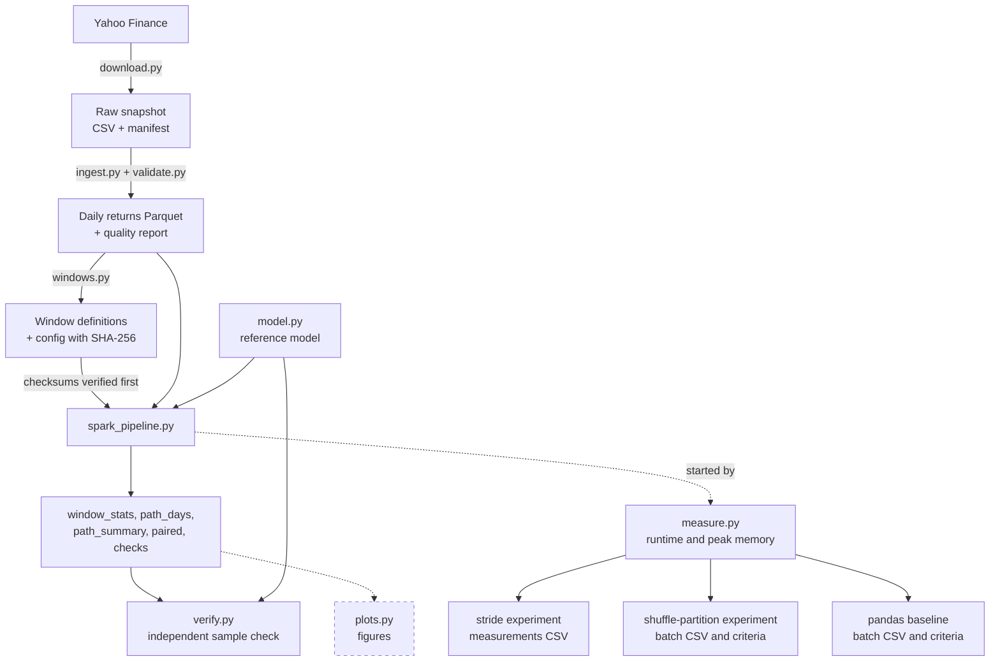

# Claude Code message 55

Session: `c82fe879-2a08-4e8f-a4c7-740b70b55e9a` · prompt sent 2026-10-22 17:18 (local time)

Redacted record: [transcript.jsonl](transcript.jsonl)

This readable view includes user/assistant messages and tool calls/results. Internal reasoning and session metadata are omitted.

Redactions (markers like `[REDACTED:email]`; home directory shown as `~`): git-user ×42, home ×540, model-reasoning ×37, private-term ×6, user ×26. Rules: `.claude/hooks/transcript_privacy.py`. The unredacted original stays local only.

## 1. User — 2026-10-22T22:18:58.402Z


<pasted_content id="e92c">
d C’s additional caching also produced less net benefit than expected, and its checks were not consistently faster than B’s.
15.4 so saving changing to no observed net saving in these phases

After adjustment, commit part b separetely, then update readme/spec status
</pasted_content id="e92c">


## 2. Assistant — 2026-10-22T22:19:21.938Z

Two adjustments, then the commits:
1. **Your sentence** is added to (d).
2. **The 15.4 result** "no saving" becomes "no observed net saving in these phases".
3. **Part B** is committed on its own.
4. **README and spec** status are updated in a second commit.

## 3. Assistant — 2026-10-22T22:19:23.990Z

### Tool call: Edit

```
{
  "replace_all": false,
  "file_path": "~/leveraged-etf-risk-analytics/docs/caching-experiment.md",
  "old_string": "**Answer (author).** I underestimated the members fill time, and the prediction of exact equality\ndid not hold. A different order of floating-point addition is a plausible explanation, but the\nspecific mechanism has not been established.",
  "new_string": "**Answer (author).** I underestimated the members fill time, and the prediction of exact equality\ndid not hold. A different order of floating-point addition is a plausible explanation, but the\nspecific mechanism has not been established. C's additional caching also produced less net benefit\nthan expected, and its checks were not consistently faster than B's."
}
```

## 4. Assistant — 2026-10-22T22:19:25.590Z

### Tool call: Edit

```
{
  "replace_all": false,
  "file_path": "~/leveraged-etf-risk-analytics/docs/caching-experiment.md",
  "old_string": "`summaries` +0.233 s and `checks` −0.001 s; net +1.686 s | fills inside; no saving; net larger |",
  "new_string": "`summaries` +0.233 s and `checks` −0.001 s; net +1.686 s | fills inside; no observed net saving in these phases; net larger |"
}
```

## 5. Assistant — 2026-10-22T22:19:29.093Z

### Tool call: Edit

```
{
  "replace_all": false,
  "file_path": "~/leveraged-etf-risk-analytics/docs/caching-experiment.md",
  "old_string": "**Part B** (2026-10-22). Section 14 gives batch-1's results as facts, with the author's statements\nin 14.2 and 14.3, and section 15 the author's answers, with facts drafted by Claude Code. The status\nat the top now describes both parts, the authorship line states that the author ran the formal\nmeasurements and wrote the answers, and a line marks the end of Part A; sections 1–13, the\npredictions included, are unchanged. This version is committed on `feature/caching` after the\nformal session.",
  "new_string": "**Part B** (2026-10-22). Section 14 gives batch-1's results as facts, with the author's statements\nin 14.2 and 14.3, and section 15 the author's answers, with facts drafted by Claude Code. After\nClaude Code's review of the answers, the author added the last sentence of (d) and had one result in\n15.4 changed to \"no observed net saving in these phases\". The status at the top now describes both\nparts, the authorship line states that the author ran the formal measurements and wrote the answers,\nand a line marks the end of Part A; sections 1–13, the predictions included, are unchanged. This\nversion is committed on `feature/caching` after the formal session."
}
```

## 6. Assistant — 2026-10-22T22:19:31.631Z

### Tool call: Bash

```
{
  "command": "uv run python -I -c \"\nimport sys\ntext = open(sys.argv[1], encoding='utf-8').read()\nbad = [(n, len(l.rstrip())) for n, l in enumerate(text.splitlines(), 1) if len(l.rstrip()) > 100 and not l.lstrip().startswith('|')]\nprint('document lines over 100 characters:', bad or 'none')\n\" docs/caching-experiment.md && git diff 6131f83 -- docs/caching-experiment.md | grep -c \"^-[^-]\" && grep -n \"no observed net saving\\|consistently faster\" docs/caching-experiment.md",
  "description": "Check widths and the two adjustments"
}
```

## 7. User — 2026-10-22T22:19:32.997Z

### Tool result

```
The file ~/leveraged-etf-risk-analytics/docs/caching-experiment.md has been updated successfully.
```

## 8. User — 2026-10-22T22:19:34.058Z

### Tool result

```
The file ~/leveraged-etf-risk-analytics/docs/caching-experiment.md has been updated successfully.
```

## 9. User — 2026-10-22T22:19:35.116Z

### Tool result

```
The file ~/leveraged-etf-risk-analytics/docs/caching-experiment.md has been updated successfully.
```

## 10. User — 2026-10-22T22:19:35.381Z

### Tool result

```
document lines over 100 characters: none
6
1082:| 11.3, C against B | fills 0.5–2 s together; memory reads save 0.3–1.5 s; net about +0.5 s | fills 1.630 s (the sum of their medians); `summaries` +0.233 s and `checks` −0.001 s; net +1.686 s | fills inside; no observed net saving in these phases; net larger |
1088:than expected, and its checks were not consistently faster than B's.
1125:15.4 changed to "no observed net saving in these phases". The status at the top now describes both
```

## 11. Assistant — 2026-10-22T22:19:38.318Z

Both adjustments are in. Sections 1–13 are still unchanged relative to `6131f83`, and no line exceeds 100 characters. Next I'll stage Part B on its own and run the privacy scan:

## 12. Assistant — 2026-10-22T22:19:40.028Z

### Tool call: Bash

```
{
  "command": "git add docs/caching-experiment.md && git diff --cached --name-status && echo \"private-plan file references (counts):\" && (git grep --cached -c -i -E \"plan\\.md|mplementation.plan\" -- docs/caching-experiment.md || echo \"  none\") && echo \"local paths, user names, e-mail, scratch locations:\" && (git grep --cached -n -i -E \"/Users/|/home/|/private/|[REDACTED:private-term]|gmail|@[a-z0-9-]+\\.(com|org|edu)|claude-501|scratchpad|/var/folders\" -- docs/caching-experiment.md || echo \"  none\")",
  "description": "Stage Part B and scan it"
}
```

## 13. User — 2026-10-22T22:19:40.877Z

### Tool result

```
M	docs/caching-experiment.md
private-plan file references (counts):
  none
local paths, user names, e-mail, scratch locations:
  none
```

## 14. Assistant — 2026-10-22T22:19:47.914Z

### Tool call: Bash

```
{
  "command": "git commit -q -F - <<'EOF' && git log -1 --format='%h %s' && git show --stat --format= HEAD\nAdd the caching experiment's results and answers (Part B)\n\ndocs/caching-experiment.md, sections 14 and 15: batch-1, run on\n2026-10-22 in the order A-B-C-C-B-A at commit 6131f83, met every\nacceptance criterion and is the analyzed batch. Section 14 gives the\nresults as facts: protocols, run log and conditions, drift, the\nmeasurements CSV, summary tables, the comparisons of section 9, the\ncaches and plans, and the output comparison, including the last-bit\ndifferences of seven floating-point columns in B and C and the row\norder of path_days. Section 15 holds the author's answers, with facts\ndrafted by Claude Code. Sections 1-13, the predictions included, are\nunchanged since Part A; the status at the top and the authorship line\ndescribe both parts.\n\nCo-Authored-By: Claude Opus 5.5 (1M context) <noreply@anthropic.com>\nEOF",
  "description": "Commit Part B of the caching document"
}
```

## 15. User — 2026-10-22T22:19:48.452Z

### Tool result

```
d8e706d Add the caching experiment's results and answers (Part B)
 docs/caching-experiment.md | 402 ++++++++++++++++++++++++++++++++++++++++++++-
 1 file changed, 396 insertions(+), 6 deletions(-)
```

## 16. Assistant — 2026-10-22T22:19:50.986Z

Part B is committed as `d8e706d`. For the README and spec status, I'll follow the baseline's completion commit (`ccf62ac`), so first I'll look at what it changed:

## 17. Assistant — 2026-10-22T22:19:52.300Z

### Tool call: Bash

```
{
  "command": "git show ccf62ac --stat --format='%s' && git show ccf62ac -- README.md docs/spec.md | grep -E \"^[-+]\" | grep -v \"^+++\\|^---\"",
  "description": "Show the baseline completion diff for README and spec"
}
```

## 18. User — 2026-10-22T22:19:52.799Z

### Tool result

```
Mark the pandas baseline complete in the README and spec

 README.md    | 41 +++++++++++++++++++++++++------------
 docs/spec.md | 67 +++++++++++++++++++++++++++++++++++++++++++-----------------
 2 files changed, 76 insertions(+), 32 deletions(-)
-| Pandas baseline: the Spark pipeline against a single-process pandas implementation, end to end, at stride 7 ([docs/pandas-baseline.md](docs/pandas-baseline.md)) | Design, code and predictions committed (Part A); measurements pending |
+| Pandas baseline: the Spark pipeline against a single-process pandas implementation, end to end, at stride 7 ([docs/pandas-baseline.md](docs/pandas-baseline.md)) | Complete; pandas had a 41.8% shorter median wall time and a 26.6% lower median peak total RSS; outputs within tolerance |
-   shuffle-partition experiments (§8).
+   shuffle-partition experiments and the pandas baseline (§8).
-   baseline's design, rules and predictions (Part A, committed before any
-   measured run), an end-to-end comparison of the Spark pipeline with a
+   baseline, an end-to-end comparison of the Spark pipeline with a
-   [session helpers](docs/baseline-session.zsh) and
-   [collector](analysis/collect_baseline_measurements.py).
+   design, rules and predictions (committed before any measured run), run log,
+   measurements and answers; the [session helpers](docs/baseline-session.zsh)
+   ran its session, and the
+   [collector](analysis/collect_baseline_measurements.py) builds its
+   measurements CSV and checks its acceptance criteria.
+- The pandas baseline
+  ([docs/pandas-baseline.md](docs/pandas-baseline.md)) compared the Spark
+  pipeline at Spark's defaults end to end with a single-process pandas
+  implementation of the same computation, on the stride-7 workload on
+  2026-10-22 (UTC): eight runs each, in the order Spark–pandas–pandas–Spark,
+  all passing every check. The pandas implementation's median wall time was
+  15.4 s against Spark's 26.4 s (41.8% shorter), and its median peak total RSS
+  1.97 against 2.68 GiB (26.6% lower), in the same direction in both halves of
+  the order; its outputs matched Spark's within the tolerance. Its model phase
+  took longer than Spark's and its other phases less time. Both call the same
+  model function but handle data, aggregate and write in their own ways, so
+  the comparison does not isolate Spark's overhead. The prediction had put
+  pandas at about 40 s, slower than Spark; no drift was detected.
-  that compares the Spark pipeline end to end with a single-process pandas
-  implementation, with its measurements pending.
+  that compared the Spark pipeline end to end with a single-process pandas
+  implementation.
-   experiments are complete ([docs/experiments.md](docs/experiments.md),
-   [docs/partition-experiment.md](docs/partition-experiment.md)). The pandas
-   baseline's Part A is committed
-   ([docs/pandas-baseline.md](docs/pandas-baseline.md)), and its formal
-   session is next. A caching experiment is optional.
+   experiments and the pandas baseline are complete
+   ([docs/experiments.md](docs/experiments.md),
+   [docs/partition-experiment.md](docs/partition-experiment.md),
+   [docs/pandas-baseline.md](docs/pandas-baseline.md)). A caching experiment
+   is optional.
-([experiments.md](experiments.md)) and the shuffle-partition experiment
-([partition-experiment.md](partition-experiment.md)); pending: the measurements
-of the pandas baseline, whose design, code and predictions are committed
+([experiments.md](experiments.md)), the shuffle-partition experiment
+([partition-experiment.md](partition-experiment.md)) and the pandas baseline
-| Stage 3 | Spark SQL analysis of the results, a reproducible environment (Docker) and performance experiments | In progress: three SQL analyses, the Docker image, the stride experiment ([experiments.md](experiments.md)) and the shuffle-partition experiment ([partition-experiment.md](partition-experiment.md)) done; pandas baseline designed, implemented and predicted ([pandas-baseline.md](pandas-baseline.md)), measurements pending; caching experiment optional |
+| Stage 3 | Spark SQL analysis of the results, a reproducible environment (Docker) and performance experiments | In progress: three SQL analyses, the Docker image, the stride experiment ([experiments.md](experiments.md)), the shuffle-partition experiment ([partition-experiment.md](partition-experiment.md)) and the pandas baseline ([pandas-baseline.md](pandas-baseline.md)) done; caching experiment optional |
-measurement (a stride experiment, a shuffle-partition experiment, and a pandas
-baseline with its measurements pending); a Docker image for the pipeline.
+measurement (a stride experiment, a shuffle-partition experiment and a pandas
+baseline); a Docker image for the pipeline.
-- **Pandas-baseline measurements** (Stage 3): the formal batch, which the author
-  runs ([pandas-baseline.md](pandas-baseline.md)).
-    B -.-> E3[pandas baseline<br/>Part A committed]
+    B --> E3[pandas baseline<br/>batch CSV and criteria]
-    class E3,F planned
+    class F planned
-  and the pandas baseline ([pandas-baseline.md](pandas-baseline.md)) is to run
-  the pandas comparison.
+  and the pandas baseline, below, ran the pandas comparison
+  ([pandas-baseline.md](pandas-baseline.md)).
+### What the pandas baseline showed (2026-10-22)
+
+Measured on the same machine with the stride-7 workload: an end-to-end
+comparison of the Spark pipeline at Spark's defaults (S) with a single-process
+pandas implementation of the same computation (P). The design, code and
+predictions were committed before any measured run. Design, run log, records
+and answers: [pandas-baseline.md](pandas-baseline.md).
+
+- **What is compared.** Both implementations call the same model function for
+  each window and produce the same tables and checks, but they build the member
+  rows, aggregate, check and write in their own ways, and P runs on one core.
+  The comparison does not isolate Spark's overhead.
+- **Runs.** Four protocols of four fresh-process runs in the order S–P–P–S, in
+  one batch. All 16 runs passed every check, no sample reached the 4.8 GiB
+  stop threshold, and the batch met every acceptance criterion. The machine
+  checks were recorded at every start, and no drift was detected (S +0.97%,
+  P +1.17%).
+- **Time.** Median wall times were 26.4 s (S) and 15.4 s (P): P's was 41.8%
+  shorter, in the same direction in both halves of the order. P's model phase
+  took longer than S's (12.1 against 8.6 s), each of its other phases took
+  less time, and P has no Spark session start (2.4 s in S).
+- **Memory and results.** Median peak total RSS was 2.68 GiB (S) and 1.97 GiB
+  (P), 26.6% lower for P in both halves. P's outputs matched S's within the
+  tolerance, and `path_days`, compared in full for two P runs, was identical.
+- **Predictions.** S's median time and peak were inside their predicted
+  ranges. P's median wall time was below its predicted band (28–60 s) and its
+  median peak above its range (0.8–1.8 GiB): the predicted time ranking was
+  reversed, while the memory ranking held. For this workload the
+  single-process pandas implementation was faster end to end, as the last
+  hypothesis of expectation 5 allowed; other sizes were not measured.
+
-| Area | Implemented (prototype, Stages 1–2, SQL analyses, Docker image, stride and shuffle-partition experiments) | Planned (Stage 3 and later) |
+| Area | Implemented (prototype, Stages 1–2, SQL analyses, Docker image, stride and shuffle-partition experiments, pandas baseline) | Planned (Stage 3 and later) |
-| Performance | fresh-process timed runs with process-tree memory sampling and a stop rule; the stride experiment (strides 21, 14 and 7, stride 3 exploratory; Spark defaults; drift detected) and its measurements CSV ([experiments.md](experiments.md)); the shuffle-partition experiment (settings A, B and C at stride 7; one batch meeting every acceptance criterion; no drift) with the partition flags, plan recording with actual partition counts, the batch collector and the session helpers ([partition-experiment.md](partition-experiment.md)); for the pandas baseline, the pandas pipeline, `measure --pipeline`, the batch collector and the session helpers | the pandas baseline's formal measurements: an end-to-end comparison of the Spark pipeline with a single-process pandas implementation at stride 7, Part A (design, code, predictions) committed ([pandas-baseline.md](pandas-baseline.md)); optional caching experiment |
+| Performance | fresh-process timed runs with process-tree memory sampling and a stop rule; the stride experiment (strides 21, 14 and 7, stride 3 exploratory; Spark defaults; drift detected) and its measurements CSV ([experiments.md](experiments.md)); the shuffle-partition experiment (settings A, B and C at stride 7; one batch meeting every acceptance criterion; no drift) with the partition flags, plan recording with actual partition counts, the batch collector and the session helpers ([partition-experiment.md](partition-experiment.md)); the pandas baseline (the Spark pipeline against a single-process pandas implementation at stride 7, end to end; one batch meeting every acceptance criterion; no drift) with the pandas pipeline, `measure --pipeline`, the batch collector and the session helpers ([pandas-baseline.md](pandas-baseline.md)) | optional caching experiment |
-| Documentation | README, [data-sources.md](data-sources.md), this specification, [experiments.md](experiments.md), [partition-experiment.md](partition-experiment.md), [pandas-baseline.md](pandas-baseline.md) (Part A), [AI-usage logs](ai-usage/README.md) | design decisions, results, demo script |
+| Documentation | README, [data-sources.md](data-sources.md), this specification, [experiments.md](experiments.md), [partition-experiment.md](partition-experiment.md), [pandas-baseline.md](pandas-baseline.md), [AI-usage logs](ai-usage/README.md) | design decisions, results, demo script |
-  baseline's Part A is committed ([pandas-baseline.md](pandas-baseline.md)): an
-  end-to-end comparison of the Spark pipeline with a single-process pandas
-  implementation, whose formal session the author runs. The caching experiment
-  is optional. The three Spark SQL analyses are done (§8).
+  baseline ([pandas-baseline.md](pandas-baseline.md)) compared the Spark
+  pipeline end to end with a single-process pandas implementation at stride 7,
+  in one batch that met every acceptance criterion; sharing the model function
+  does not isolate Spark's overhead, and only one workload was measured. The
+  caching experiment is optional. The three Spark SQL analyses are done (§8).
```

## 19. Assistant — 2026-10-22T22:20:11.297Z

### Tool call: Bash

```
{
  "command": "echo \"=== README\" && grep -n -i \"caching\\|pandas baseline\\|pandas-baseline\\|stage 3\" README.md && echo \"=== spec\" && grep -n -i \"caching\\|pandas baseline\\|pandas-baseline\\|stage 3\\|What the pandas baseline showed\\|^### What\\|E3\\[\" docs/spec.md",
  "description": "Find caching and status mentions in README and spec"
}
```

## 20. User — 2026-10-22T22:20:11.795Z

### Tool result

```
=== README
21:| Pandas baseline: the Spark pipeline against a single-process pandas implementation, end to end, at stride 7 ([docs/pandas-baseline.md](docs/pandas-baseline.md)) | Complete; pandas had a 41.8% shorter median wall time and a 26.6% lower median peak total RSS; outputs within tolerance |
22:| Caching experiment | Optional |
32:   shuffle-partition experiments and the pandas baseline (§8).
46:6. **[docs/pandas-baseline.md](docs/pandas-baseline.md)**: the pandas
127:- The pandas baseline
128:  ([docs/pandas-baseline.md](docs/pandas-baseline.md)) compared the Spark
196:  ([pandas-baseline.md](docs/pandas-baseline.md) 4).
261:  partition counts Spark used; and a pandas baseline, committed the same way,
293:   experiments and the pandas baseline are complete
296:   [docs/pandas-baseline.md](docs/pandas-baseline.md)). A caching experiment
302:   and Redis for a job queue and a result cache, with recovery and caching
=== spec
6:([partition-experiment.md](partition-experiment.md)) and the pandas baseline
7:([pandas-baseline.md](pandas-baseline.md)); optional: a caching experiment;
18:| Stage 3 | Spark SQL analysis of the results, a reproducible environment (Docker) and performance experiments | In progress: three SQL analyses, the Docker image, the stride experiment ([experiments.md](experiments.md)), the shuffle-partition experiment ([partition-experiment.md](partition-experiment.md)) and the pandas baseline ([pandas-baseline.md](pandas-baseline.md)) done; caching experiment optional |
19:| Extension (optional) | Job queue (MySQL job table, Kafka), result cache (Redis), Docker Compose; recovery and caching experiments (§11) | Planned |
52:3. **Spark performance.** How do workload size, partitioning and caching affect
56:recovery, result caching) are in §11; they concern the infrastructure around
128:| Pandas-baseline batch | `data/outputs-baseline/<batch>/` | `measure.py --pipeline` through `docs/baseline-session.zsh`; `analysis/collect_baseline_measurements.py` | protocols and runs of S (the Spark pipeline) and P (the pandas pipeline), `positions.tsv`, `run-log.txt`, and the collector's `measurements.csv` and `acceptance.json` ([pandas-baseline.md](pandas-baseline.md) 2.4, 4.3) |
160:  pandas_pipeline.py implemented  the pipeline's results in one process with pandas, without Spark (the pandas baseline)
166:                                  collect_baseline_measurements.py (Claude Code): a pandas-baseline batch's CSV and criteria
191:    B --> E3[pandas baseline<br/>batch CSV and criteria]
413:### What the stride-21 run showed (`full-2026-10-12`, after the cleanup)
479:### What the stride experiment showed (2026-10-19)
519:  and the pandas baseline, below, ran the pandas comparison
520:  ([pandas-baseline.md](pandas-baseline.md)).
522:### What the shuffle-partition experiment showed (2026-10-22)
563:### What the pandas baseline showed (2026-10-22)
569:and answers: [pandas-baseline.md](pandas-baseline.md).
597:| Area | Implemented (prototype, Stages 1–2, SQL analyses, Docker image, stride and shuffle-partition experiments, pandas baseline) | Planned (Stage 3 and later) |
603:| Performance | fresh-process timed runs with process-tree memory sampling and a stop rule; the stride experiment (strides 21, 14 and 7, stride 3 exploratory; Spark defaults; drift detected) and its measurements CSV ([experiments.md](experiments.md)); the shuffle-partition experiment (settings A, B and C at stride 7; one batch meeting every acceptance criterion; no drift) with the partition flags, plan recording with actual partition counts, the batch collector and the session helpers ([partition-experiment.md](partition-experiment.md)); the pandas baseline (the Spark pipeline against a single-process pandas implementation at stride 7, end to end; one batch meeting every acceptance criterion; no drift) with the pandas pipeline, `measure --pipeline`, the batch collector and the session helpers ([pandas-baseline.md](pandas-baseline.md)) | optional caching experiment |
605:| Systems extension | — | MySQL job table, Kafka job queue, worker and reconciler, Redis result cache, Docker Compose, recovery and caching experiments (§11) |
606:| Documentation | README, [data-sources.md](data-sources.md), this specification, [experiments.md](experiments.md), [partition-experiment.md](partition-experiment.md), [pandas-baseline.md](pandas-baseline.md), [AI-usage logs](ai-usage/README.md) | design decisions, results, demo script |
637:  baseline ([pandas-baseline.md](pandas-baseline.md)) compared the Spark
641:  caching experiment is optional. The three Spark SQL analyses are done (§8).
```

## 21. Assistant — 2026-10-22T22:20:14.822Z

I'll read the README passages around those lines so the edits fit their context.

## 22. Assistant — 2026-10-22T22:20:15.794Z

### Tool call: Bash

```
{
  "command": "sed -n '1,60p' README.md",
  "description": "Read the README's status table and overview"
}
```

## 23. User — 2026-10-22T22:20:16.358Z

### Tool result

```
# Leveraged ETF Risk Analytics

How does a fund that resets to twice its underlying every trading day behave
over a one-year holding period, compared with the underlying and with twice its
return? This CS544 independent project replays a daily-reset 1x/2x model on the
daily return history of NVDA, AAPL, MSFT, TSLA and QQQ over 252-trading-day
windows, runs it in PySpark with full-scale checks, and analyzes the results
with Spark SQL. The results describe historical windows of a few tickers; they
are not forecasts, and the model ignores fees, financing and execution.

## Status

| Part | Status |
|---|---|
| Data: download with manifest, checksum-enforced ingest, validation, daily returns in Parquet | Implemented |
| Model and Spark pipeline: 252-day windows on a shared trading-day grid, 1x and 2x for each window, full-scale checks, an independent sample check, measurement tooling | Implemented |
| Three Spark SQL analyses of the results ([`analysis/`](analysis/)) | Implemented |
| Docker image for the pipeline | Implemented |
| Stride experiment: runtime and memory at strides 21, 14 and 7 ([docs/experiments.md](docs/experiments.md)) | Complete; drift detected, stride 3 exploratory only |
| Shuffle-partition experiment: three Spark partition settings at stride 7 ([docs/partition-experiment.md](docs/partition-experiment.md)) | Complete; B (200 partitions, coalescing off) slower than A and C; no clear memory difference; outputs within tolerance |
| Pandas baseline: the Spark pipeline against a single-process pandas implementation, end to end, at stride 7 ([docs/pandas-baseline.md](docs/pandas-baseline.md)) | Complete; pandas had a 41.8% shorter median wall time and a 26.6% lower median peak total RSS; outputs within tolerance |
| Caching experiment | Optional |
| Figures and final write-up | Planned |
| Optional systems extension: MySQL job table, Kafka job queue, Redis result cache | Planned ([spec](docs/spec.md), §11) |

## Reading guide

1. **This README**: status, key results and how to run everything.
2. **[docs/spec.md](docs/spec.md)**: the research questions (§2), the model and
   its assumptions (§3), how results are checked (§6), the window design (§7),
   the full results of the stride-21 run and summaries of the stride and
   shuffle-partition experiments and the pandas baseline (§8).
3. **[docs/data-sources.md](docs/data-sources.md)**: where the data comes from,
   the checks run on it, and what is not verified.
4. **[docs/experiments.md](docs/experiments.md)**: the stride experiment, with
   its design and predictions (committed before any measured run), run log,
   deviations, measurements and answers;
   [`collect_measurements.py`](analysis/collect_measurements.py) builds its
   measurements CSV from the run records.
5. **[docs/partition-experiment.md](docs/partition-experiment.md)**: the
   shuffle-partition experiment, with its design, rules and predictions
   (committed before any measured run), run log, deviations, measurements,
   plans and answers; the [session helpers](docs/partition-session.zsh) ran
   its session, and the [collector](analysis/collect_partition_measurements.py)
   builds its measurements CSV and checks its acceptance criteria.
6. **[docs/pandas-baseline.md](docs/pandas-baseline.md)**: the pandas
   baseline, an end-to-end comparison of the Spark pipeline with a
   single-process pandas implementation of the same computation, with its
   design, rules and predictions (committed before any measured run), run log,
   measurements and answers; the [session helpers](docs/baseline-session.zsh)
   ran its session, and the
   [collector](analysis/collect_baseline_measurements.py) builds its
   measurements CSV and checks its acceptance criteria.
7. **The analyses**: [`sql_overview.py`](analysis/sql_overview.py) (counts and
   medians per ticker), [`sql_comparison.py`](analysis/sql_comparison.py) (how
   often 2x beats twice the 1x return) and
   [`sql_sensitivity.py`](analysis/sql_sensitivity.py) (medians without the
   windows that use an unverified day).
8. **The code**, in data-flow order: in `src/etf_risk/`, `download` → `ingest`
   (with `validate`) → `windows` → `spark_pipeline` (which runs `model`) →
```

## 24. Assistant — 2026-10-22T22:20:18.516Z

### Tool call: Bash

```
{
  "command": "sed -n '95,150p;185,200p;250,310p' README.md",
  "description": "Read README results and next-steps passages"
}
```

## 25. User — 2026-10-22T22:20:19.040Z

### Tool result

````
- Runtime and memory were measured on one Apple Silicon laptop (8 cores, 8 GiB
  RAM), with Spark in local mode and, apart from the shuffle-partition
  experiment, default settings; the numbers describe that machine and those
  configurations, not others. For the run of record, the median wall time over
  three measured runs was 44.7 s and the median peak memory 1.27 GiB (summed
  resident memory of the run's processes, sampled every 0.25 s).
- The stride experiment ([docs/experiments.md](docs/experiments.md)) measured
  the same stride-21 workload and strides 14 and 7 (1.5 and 3 times the
  windows) on 2026-10-19: median wall times 22.2, 20.3 and 25.7 s, median
  peaks 2.62 to 2.70 GiB, and every check passed in all 20 runs. At stride 21
  that is half the run of record's time and about twice its memory, with more
  memory free before the runs; the records do not establish why. A linear fit
  over the three strides gives an intercept of 18.8 s (85% of the stride-21
  median) and 1.2 ms per window: an estimate from three points, not measured
  overhead. A repeated stride-21 protocol at the end had an 18.3% shorter
  median wall time than the first, beyond the 10% drift tolerance, so
  comparisons across strides are marked as affected. Stride 3 was run although
  the experiment's memory rule did not admit it; its results (40.2 s,
  2.73 GiB) are exploratory only.
- The shuffle-partition experiment
  ([docs/partition-experiment.md](docs/partition-experiment.md)) ran the
  stride-7 workload on 2026-10-22 (UTC) with three settings: A, Spark's
  defaults (200 shuffle partitions, AQE coalescing on); B, 200 partitions with
  coalescing off; C, 8 partitions with coalescing off. Eight runs each, in the
  order A–B–C–C–B–A, all passed every check. Median times without the plan
  recording were 26.5, 44.6 and 25.3 s: B's was 69% longer than A's and 77%
  longer than C's, in the same direction in both halves of the order, while A
  and C showed no clear difference. Median peaks were 2.69 GiB in all three,
  and `paired` and `path_summary` matched A's within the tolerance. In B, one
  join stayed a sort-merge join where AQE chose a broadcast join in A and C.
  No drift was detected; the machine checks were recorded only before the
  first protocol, and the last protocol followed a two-hour break.
- The pandas baseline
  ([docs/pandas-baseline.md](docs/pandas-baseline.md)) compared the Spark
  pipeline at Spark's defaults end to end with a single-process pandas
  implementation of the same computation, on the stride-7 workload on
  2026-10-22 (UTC): eight runs each, in the order Spark–pandas–pandas–Spark,
  all passing every check. The pandas implementation's median wall time was
  15.4 s against Spark's 26.4 s (41.8% shorter), and its median peak total RSS
  1.97 against 2.68 GiB (26.6% lower), in the same direction in both halves of
  the order; its outputs matched Spark's within the tolerance. Its model phase
  took longer than Spark's and its other phases less time. Both call the same
  model function but handle data, aggregate and write in their own ways, so
  the comparison does not isolate Spark's overhead. The prediction had put
  pandas at about 40 s, slower than Spark; no drift was detected.

## Running

Requires Python 3.12, Java 17 and [uv](https://docs.astral.sh/uv/); run the
commands from the repository root. Memory use has been measured on one machine
only (see Key results): there, runs at strides 21 to 7 peaked at 1.2 to 2.8 GiB,
and the exploratory stride-3 runs at up to 2.8 GiB; other machines, and Spark
settings beyond the shuffle-partition experiment's three, have not been
measured.

```bash
  differ slightly ([data-sources.md](docs/data-sources.md)).
- Nothing is overwritten: `windows` refuses an existing folder (unless
  `--overwrite`), and `spark_pipeline` asks for a new `--run-id`.
- `spark_pipeline` also takes `--shuffle-partitions N` and `--coalesce on|off`
  (Spark settings, refused inside an existing Spark session) and
  `--record-plans`, which writes `plans.json` with the run's final plans and
  the partition counts Spark used
  ([partition-experiment.md](docs/partition-experiment.md) 4).
- `etf_risk.pandas_pipeline` takes `--windows`, `--out-root` and `--run-id`
  and writes the Spark pipeline's outputs from one process, without Spark;
  `etf_risk.measure --pipeline pandas` times it
  ([pandas-baseline.md](docs/pandas-baseline.md) 4).
- Strides below 21 need `--allow-dense-stride`. Strides 14, 7 and 3 were
  measured in the stride experiment (stride 3 as exploratory only); stride 1
  has not been run.
- The 2020–2025 prototype regression needs the prototype CSVs, which were
- **PyArrow and Parquet**: daily returns, window definitions and results with
  explicit schemas.
- **PySpark and Spark SQL**: grouped pandas functions and a broadcast join over
  every window; DataFrame aggregation and three SQL analyses; execution plans
  read with `explain("formatted")`.
- **Docker**: an image that reproduces the native results exactly on this
  project's machine.
- **Performance measurement**: fresh-process runs with memory sampling and a
  stop rule; a stride experiment whose design and predictions were committed
  before any measured run; a shuffle-partition experiment, likewise committed
  in advance, that compared three partition settings and recorded the
  partition counts Spark used; and a pandas baseline, committed the same way,
  that compared the Spark pipeline end to end with a single-process pandas
  implementation.

## AI assistance

Most of the code, tests and documentation were written with Claude Code (Opus
5.5) in reviewable stages. I set the requirements and constraints of each
stage, made the design decisions (often choosing among options Claude Code
proposed), reviewed results and diffs, and approved each commit. Each file
written or drafted with AI says so in its header (`AI contribution: ...`),
together with how it was checked.

- **Written by me:** the breach branch of `simulate_path()` in
  `src/etf_risk/model.py`, and the SQL queries in `analysis/`. The queries were
  tutored exercises: Claude Code set the tasks and acceptance criteria and
  reviewed my attempts and my reading of the execution plan, without writing
  the queries. It later added the scripts' command-line input.
- **Other tools:** the transcript hook (`.claude/hooks/save_transcript.py`) was
  first drafted with Codex assistance, inspired by a `log_ai.py` script from a
  CS639 project; Claude Code later changed it to save one log per message and
  wrote its redaction module. The 2020–2025 prototype data was downloaded by a
  check written with Codex assistance outside this repository.
- **Records:** `docs/ai-usage/` holds redacted per-message transcripts of the
  Claude Code sessions, which I review before committing them
  ([docs/ai-usage/README.md](docs/ai-usage/README.md)). The hook does not commit
  or push files and has been checked against real sessions; conversations with
  other AI tools are not recorded.

## Next steps

1. **Performance experiments** (mine): the stride and shuffle-partition
   experiments and the pandas baseline are complete
   ([docs/experiments.md](docs/experiments.md),
   [docs/partition-experiment.md](docs/partition-experiment.md),
   [docs/pandas-baseline.md](docs/pandas-baseline.md)). A caching experiment
   is optional.
2. **Data**: compare the 36 unverified extreme days with a second source, and
   review the data's terms of use.
3. **Figures and the final write-up** (Stage 4).
4. **Optional systems extension** (spec §11): Docker Compose with MySQL, Kafka
   and Redis for a job queue and a result cache, with recovery and caching
   experiments.
````

## 26. Assistant — 2026-10-22T22:20:21.174Z

Now the spec passages: the status lines, the artifacts table, the diagram, the §8 results, the implemented/planned table and the closing status.

## 27. Assistant — 2026-10-22T22:20:22.105Z

### Tool call: Bash

```
{
  "command": "sed -n '1,22p;120,132p;150,200p' docs/spec.md",
  "description": "Read spec status, artifacts and diagram passages"
}
```

## 28. Assistant — 2026-10-22T22:20:22.960Z

### Tool call: Bash

```
{
  "command": "sed -n '505,645p' docs/spec.md",
  "description": "Read spec results sections and status table"
}
```

## 29. User — 2026-10-22T22:20:23.459Z

### Tool result

````
# Leveraged ETF Risk Analytics — specification

Last updated 2026-10-22. Implemented: the pipeline, three Spark SQL analyses of
its results, a Docker image, the stride experiment
([experiments.md](experiments.md)), the shuffle-partition experiment
([partition-experiment.md](partition-experiment.md)) and the pandas baseline
([pandas-baseline.md](pandas-baseline.md)); optional: a caching experiment;
planned: an optional systems extension with MySQL, Kafka and Redis (§11).
Every section separates what is **implemented** from what is **planned**.
Planned parts describe intentions, not results, and may change when each stage
is reviewed.

| Stage | Scope | Status |
|---|---|---|
| Prototype | Reference model; Spark run over one full-period path per ticker and leverage; Python/Spark consistency checks; 2020–2025 data | **Implemented** (now expressed as full-period windows) |
| Stage 1 | Full-history download, checksum-enforced ingestion, data validation, [data-sources.md](data-sources.md) | **Implemented** |
| Stage 2 | Fixed 252-trading-day holding windows, with the Spark grouping keys, 1x/2x pairing, breach end dates and reference check reworked together; a first sparse-stride run with measured runtime and memory | **Implemented**, including the review cleanup; stride-21 run reviewed |
| Stage 3 | Spark SQL analysis of the results, a reproducible environment (Docker) and performance experiments | In progress: three SQL analyses, the Docker image, the stride experiment ([experiments.md](experiments.md)), the shuffle-partition experiment ([partition-experiment.md](partition-experiment.md)) and the pandas baseline ([pandas-baseline.md](pandas-baseline.md)) done; caching experiment optional |
| Extension (optional) | Job queue (MySQL job table, Kafka), result cache (Redis), Docker Compose; recovery and caching experiments (§11) | Planned |
| Stage 4 | Figures, final documentation and demo | Planned |

## 1. Purpose and scope
| Daily returns | `data/processed/<snapshot>/daily_returns/<TICKER>.parquet` | `ingest.py` | `ticker` string, `date` date32, `adjusted_price` double, `daily_return` double (null on the first row); schema metadata naming the source, snapshot and checksums |
| Quality report | `data/processed/<snapshot>/quality_report.json` | `ingest.py` | per-ticker check results, a verification-status block, and the list of unverified extreme days |
| Window definitions | `data/windows/<snapshot>/<name>/` (`windows.parquet`, `config.json`) | `windows.py` | one row per window: `window_kind, ticker, window_days, entry_date, first_return_date, exit_date, entry_row, stride, calendar_year, contains_unverified_day, unverified_day_count, entry_on_unverified_day`; the config records the SHA-256 of every return file, of `quality_report.json` and of `windows.parquet`, the self-check results, the flag rule, each return file's raw-manifest hash, and the code that built it (commit, whether the worktree was clean, SHA-256 of every source file and of `uv.lock`) |
| Run output | `data/outputs/windows/<snapshot>/<name>/<run id>/` | `spark_pipeline.py`, `verify.py` | `window_stats/` (one row per window, no model), `path_days/` (per window, leverage and day; partitioned by ticker), `path_summary/` (per window and leverage), `paired/` (per window, 1x and 2x; for a breached 2x path the full-window 2x drawdown and turnover columns are null and the partial values sit in `*_pre_breach` columns with `days_ok_2x`), `checks.json`, `run.json` (including the code provenance and the JVM's measured maximum heap), and `verify.json` from the sample check |
| Measurement records | `data/outputs/windows/<snapshot>/<name>/protocol-<UTC time>.json`, `<run id>.log` (the stride experiment: under `data/outputs-experiments/`) | `measure.py` | per run: wall time, in-process phase timings, peak summed RSS in total and per process type, stop-rule status and its limits |
| Measurements CSV | `data/outputs-experiments/measurements.csv` | `analysis/collect_measurements.py` | one row per started run of the stride experiment: identity and role, input size, Spark settings, summed stage task counts, wall and phase times, peak RSS by process type, sampling, code ([experiments.md](experiments.md) 5.6) |
| Execution plans | `plans.json` in a run folder | `spark_pipeline.py --record-plans` (`plans.py`) | for every SQL execution of the run: its phase and final plan text, each shuffle exchange's requested and runtime partition counts, each AQE shuffle read's mark and partition count ([partition-experiment.md](partition-experiment.md) 4.2) |
| Shuffle-partition batch | `data/outputs-partitions/<batch>/` | `measure.py` through `docs/partition-session.zsh`; `analysis/collect_partition_measurements.py` | protocols and runs of configurations A, B and C, `positions.tsv`, `run-log.txt`, and the collector's `measurements.csv` and `acceptance.json` ([partition-experiment.md](partition-experiment.md) 2.4, 4.3) |
| Pandas-baseline batch | `data/outputs-baseline/<batch>/` | `measure.py --pipeline` through `docs/baseline-session.zsh`; `analysis/collect_baseline_measurements.py` | protocols and runs of S (the Spark pipeline) and P (the pandas pipeline), `positions.tsv`, `run-log.txt`, and the collector's `measurements.csv` and `acceptance.json` ([pandas-baseline.md](pandas-baseline.md) 2.4, 4.3) |

Snapshots: `full-2026-10-12` (five tickers, each from its first trading day to
2025-12-31; used for the main analysis) and the 2020–2025 snapshot of the four
stocks (prototype only). Settings, checksums and limitations are recorded in
  download.py        implemented  Yahoo Finance -> raw snapshot + manifest (network; "download" dependency group)
  ingest.py          implemented  raw snapshot -> validated daily returns (Parquet) + quality report
  validate.py        implemented  data checks used by ingest (pure functions)
  model.py           implemented  sequential reference model for one path
  windows.py         implemented  window definitions and their checksums; verify_checksums() for later steps
  spark_pipeline.py  implemented  window members, model per window, Spark summaries, 1x/2x pairing, full-scale checks
  verify.py          implemented  sample check against an independent Python slicing of each window
  measure.py         implemented  fresh-process timed runs, process-tree memory sampling, stop rule
  provenance.py      implemented  code state for every record (commit, worktree state, SHA-256 of sources and uv.lock); repo-relative paths
  plans.py           implemented  a run's final execution plans and AQE partition counts (spark_pipeline --record-plans)
  pandas_pipeline.py implemented  the pipeline's results in one process with pandas, without Spark (the pandas baseline)
  plots.py           planned      figures from result files (Stage 4)
analysis/            implemented  three Spark SQL analyses of a run's paired table (project author):
                                  sql_overview.py, sql_comparison.py, sql_sensitivity.py;
                                  collect_measurements.py (with Claude Code): the stride experiment's measurements CSV;
                                  collect_partition_measurements.py (Claude Code): a shuffle-partition batch's CSV and criteria;
                                  collect_baseline_measurements.py (Claude Code): a pandas-baseline batch's CSV and criteria
tests/               implemented  model, validation, ingest, download, windows, Spark consistency and failure
                                  injection, sample check, measurement, provenance, AI-log tooling, partition
                                  flags, plan recording, the partition collector and session helpers, the pandas
                                  pipeline against the Spark pipeline, the baseline collector and session helpers
.claude/hooks/       implemented  per-message AI-usage logs with redaction (project tooling, not analysis)
Dockerfile, docker/  implemented  pipeline image and its build and run scripts (data mounted, never copied in)
```

Names of planned modules are provisional.



Boxes with solid borders are implemented; dashed boxes are planned.
`measure.py` starts each timed `spark_pipeline.py` run as a fresh process.

Inside `spark_pipeline.py`: every SHA-256 in the window config is verified
````

## 30. User — 2026-10-22T22:20:23.462Z

### Tool result

```
  the timed fixed parts (Spark start-up and the time outside the pipeline's
  clock) took 4.4 s. The model phase grew 1.66 times while the windows grew 3
  times. Median peak memory rose only from 2.62 to 2.70 GiB; the driver JVM's
  resident memory exceeded its 1.0 GiB heap by 0.52 to 0.57 GiB.
- **Against the run of record.** At stride 21 the median wall time was half
  the run of record's (22.2 against 44.7 s) and the median peak about twice
  (2.62 against 1.27 GiB), with 3.0–3.5 instead of 1.3–1.6 GiB free before
  the runs. The code (apart from `provenance.py`), the windows and the Spark
  settings were the same; the records cannot establish the cause.
- **Not measured.** The shuffle partition counts Spark actually used (only the
  200 requested and the summed stage task counts per phase were recorded),
  spilling and CPU use; the single-process pandas comparison was not run. The
  shuffle-partition experiment, below, recorded the actual partition counts of
  its own runs ([partition-experiment.md](partition-experiment.md) 4.2, 14.8),
  and the pandas baseline, below, ran the pandas comparison
  ([pandas-baseline.md](pandas-baseline.md)).

### What the shuffle-partition experiment showed (2026-10-22)

Measured on the same machine with the stride experiment's stride-7 workload,
varying only three Spark settings; the design, code and predictions were
committed before any measured run. Design, run log, records and answers:
[partition-experiment.md](partition-experiment.md).

- **Settings.** A: Spark's defaults, set explicitly (200 shuffle partitions,
  AQE coalescing on); B: 200 partitions, coalescing off; C: 8 partitions (one
  per core), coalescing off. AQE stayed enabled in all three.
- **Runs.** Six protocols of four fresh-process runs (one warm-up, three
  measured) in the order A–B–C–C–B–A, in one batch. All 24 runs passed every
  check, no sample reached the 4.8 GiB stop threshold, and the batch met every
  acceptance criterion: one code state, unchanged inputs, settings verified in
  the recorded configuration and the execution plans, and outputs matching A's.
- **Time.** Median times without the plan recording were 26.5 s (A), 44.6 s
  (B) and 25.3 s (C). B's median was 69% longer than A's and 77% longer than
  C's, in the same direction in both halves of the order. A's was 1.18 s above
  C's, below the experiment's threshold of 10% of A's median, so A and C show
  no clear difference. B's extra time over A fell mostly in the summaries
  (7.6 s), the window statistics (5.5 s) and the model phase (4.0 s).
- **Plans.** In A, AQE coalesced ten shuffle reads to 1 to 9 partitions; in B,
  every read used all 200. B's summed stage task counts were 3.3 to 19.7 times
  A's, and it wrote 1,584 output files against A's 50. In B, the join behind
  the window statistics stayed a sort-merge join: the shuffle feeding its
  aggregate side wrote 99.9 MiB, above the recorded 10 MiB broadcast threshold,
  against 6.3 MiB in A and 5.6 MiB in C, where AQE chose a broadcast join.
- **Memory and results.** Median peaks were 2.69 GiB in all three settings,
  with no clear difference. `paired` and `path_summary` matched A's in every
  run: A's runs exactly, and B's and C's within the tolerance, differing only
  in the last bits of 12 floating-point columns (at most 2.1e-14 in `paired`
  and 1.8e-11 in `path_summary`).
- **Predictions.** All three median times and peaks were inside their
  predicted ranges, and the predicted comparisons held. B's median was 35%
  above its predicted 33 s; the prediction left out the sort-merge join, and
  the records cannot separate the costs of the mechanisms.
- **Conditions.** No drift was detected: A's two protocols, three hours apart,
  differed by 0.9%. The machine checks were recorded only before the first
  protocol, and the last protocol followed a two-hour break. CPU time,
  spilling and GC were not measured.

### What the pandas baseline showed (2026-10-22)

Measured on the same machine with the stride-7 workload: an end-to-end
comparison of the Spark pipeline at Spark's defaults (S) with a single-process
pandas implementation of the same computation (P). The design, code and
predictions were committed before any measured run. Design, run log, records
and answers: [pandas-baseline.md](pandas-baseline.md).

- **What is compared.** Both implementations call the same model function for
  each window and produce the same tables and checks, but they build the member
  rows, aggregate, check and write in their own ways, and P runs in one process.
  The comparison does not isolate Spark's overhead.
- **Runs.** Four protocols of four fresh-process runs in the order S–P–P–S, in
  one batch. All 16 runs passed every check, no sample reached the 4.8 GiB
  stop threshold, and the batch met every acceptance criterion. The machine
  checks were recorded at every start, and no drift was detected (S +0.97%,
  P +1.17%).
- **Time.** Median wall times were 26.4 s (S) and 15.4 s (P): P's was 41.8%
  shorter, in the same direction in both halves of the order. P's model phase
  took longer than S's (12.1 against 8.6 s), each of its other phases took
  less time, and P has no Spark session start (2.4 s in S).
- **Memory and results.** Median peak total RSS was 2.68 GiB (S) and 1.97 GiB
  (P). Overall, P's median peak total RSS was 26.6% lower; it was lower in both
  halves. P's outputs matched S's within the tolerance, and `path_days`,
  compared in full for two P runs, was identical.
- **Predictions.** S's median time and peak were inside their predicted
  ranges. P's median wall time was below its predicted band (28–60 s) and its
  median peak above its range (0.8–1.8 GiB): the predicted time ranking was
  reversed, while the memory ranking held. For this workload the
  single-process pandas implementation was faster end to end, as the last
  hypothesis of expectation 5 allowed; other sizes were not measured.

## 9. Status summary

| Area | Implemented (prototype, Stages 1–2, SQL analyses, Docker image, stride and shuffle-partition experiments, pandas baseline) | Planned (Stage 3 and later) |
|---|---|---|
| Data | download with manifest; five-ticker full-history snapshot; checksum-enforced ingest; calendar, split-day, dividend, zero-volume and flat-bar checks; list of unverified extreme days | second-source comparison; terms-of-use review |
| Model | daily-reset model, breach rule, drawdown, rebalance; hand-calculated tests; daily turnover and realized variance per window (computed in Spark) | — |
| Windows | 252-day rolling windows on a shared NYSE start grid (run at stride 21); calendar-year supplement; full-period windows for the prototype; unverified-day flags over all price dates (conservative rule); self-checked, checksummed definitions with code provenance; strides 14, 7 and 3 built and run for the stride experiment | stride 1 (excluded for now, [experiments.md](experiments.md) 1.3) |
| Spark | window members joined to broadcast returns; one grouped pandas call per window for both leverages; count-guarded Spark summaries; 1x/2x pairing on the window key with pre-breach values kept apart; scheduled vs actual end dates; ten full-scale checks; `verify` sample check; three Spark SQL analyses of the paired results (project author, §8) | — |
| Performance | fresh-process timed runs with process-tree memory sampling and a stop rule; the stride experiment (strides 21, 14 and 7, stride 3 exploratory; Spark defaults; drift detected) and its measurements CSV ([experiments.md](experiments.md)); the shuffle-partition experiment (settings A, B and C at stride 7; one batch meeting every acceptance criterion; no drift) with the partition flags, plan recording with actual partition counts, the batch collector and the session helpers ([partition-experiment.md](partition-experiment.md)); the pandas baseline (the Spark pipeline against a single-process pandas implementation at stride 7, end to end; one batch meeting every acceptance criterion; no drift) with the pandas pipeline, `measure --pipeline`, the batch collector and the session helpers ([pandas-baseline.md](pandas-baseline.md)) | optional caching experiment |
| Environment | uv lockfile; pandas below 3 for PySpark; pandas-market-calendars 5.5.0, yfinance 1.7.0 and psutil 7.2.2 pinned exactly; Docker image for the pipeline (Python 3.12, Java 17, locked dependencies, base images pinned by digest; data mounted, not copied; commit recorded at build time) | a NumPy pin (pandas 2.3 emits deprecation warnings under NumPy 2.5) |
| Systems extension | — | MySQL job table, Kafka job queue, worker and reconciler, Redis result cache, Docker Compose, recovery and caching experiments (§11) |
| Documentation | README, [data-sources.md](data-sources.md), this specification, [experiments.md](experiments.md), [partition-experiment.md](partition-experiment.md), [pandas-baseline.md](pandas-baseline.md), [AI-usage logs](ai-usage/README.md) | design decisions, results, demo script |

## 10. Known issues and open items after the Stage 2 cleanup

- The three prototype problems listed for Stage 2 (the ticker-only join, end
  dates taken from simulated rows, collecting every summary for the reference
  check) are fixed as described in sections 6 and 7.
- The Stage 2 review findings are fixed: the unverified flag now includes the
  entry date (a conservative rule change), partial pre-breach 2x values are
  stored only in `*_pre_breach` columns, check 10 covers every count-guarded
  value in both directions, definitions are self-checked, records carry code
  provenance and the measured JVM heap, pairing refuses leverages other than 1x
  and 2x, and config paths resolve against the repository root. The earlier
  definitions and runs are kept unchanged next to a `SUPERSEDED.txt` note
  pointing to the `-r2` folders.
- Strides 14, 7 and 3 were run in the stride experiment, stride 3 only as an
  exploratory protocol that the experiment's memory rule did not admit; stride
  1 has not been run.
- Performance has been measured on one machine only, with Spark's default
  settings except in the shuffle-partition experiment. In the stride
  experiment the repeated stride-21 protocol's median wall time was 18.3% below
  the first's (drift beyond the 10% tolerance), the apps open during its last
  two protocols are uncertain, and the shuffle partition counts Spark actually
  used, spilling and CPU use were not recorded
  ([experiments.md](experiments.md) 5.3, 5.5, 6.5). The shuffle-partition
  experiment ([partition-experiment.md](partition-experiment.md)) recorded the
  partition counts, but its machine checks only before the first protocol,
  and its last protocol followed a two-hour break (14.3); CPU time, spilling
  and GC were not measured. Its code and tests are by Claude Code; its
  predictions were drafted with Claude Code and approved by the project
  author, who ran its formal session and wrote its answers. The pandas
  baseline ([pandas-baseline.md](pandas-baseline.md)) compared the Spark
  pipeline end to end with a single-process pandas implementation at stride 7,
  in one batch that met every acceptance criterion; sharing the model function
  does not isolate Spark's overhead, and only one workload was measured. The
  caching experiment is optional. The three Spark SQL analyses are done (§8).
- 239 of the 1,790 stride-21 windows (13%), and 30% of NVDA's and 33% of TSLA's,
  use the price of an unverified extreme day. Results are also shown without
  them as a **sensitivity analysis**: the flagged windows are a non-random
  subset (periods with extreme market days), so the comparison shows how much
```

## 31. Assistant — 2026-10-22T22:21:39.911Z

### Tool call: Bash

```
{
  "command": "sed -n '56,72p' README.md && echo ----- && sed -n '140,158p' docs/spec.md",
  "description": "Read the README guide tail and spec file tree head"
}
```

## 32. User — 2026-10-22T22:21:40.242Z

### Tool result

````
   often 2x beats twice the 1x return) and
   [`sql_sensitivity.py`](analysis/sql_sensitivity.py) (medians without the
   windows that use an unverified day).
8. **The code**, in data-flow order: in `src/etf_risk/`, `download` → `ingest`
   (with `validate`) → `windows` → `spark_pipeline` (which runs `model`) →
   `verify`; `measure` times runs, `plans` records a run's execution plans,
   and `pandas_pipeline` computes the same results in one process without
   Spark. Module overview: spec §5.
9. **How AI was used**: [AI assistance](#ai-assistance) below.

## Key results

From the run of record: snapshot `full-2026-10-12` (daily history through
2025-12-31), 252-day windows starting every 21 trading days. The windows
overlap, so these numbers describe one history, not independent samples; spec
§8 has the details.

-----
extreme days are unverified**, including AAPL 2000-09-29 (−51.9%).

### Planned

- **Figures** (Stage 4): generated from the result files, never edited by hand.

## 5. Module hierarchy and data flow

```text
src/etf_risk/
  download.py        implemented  Yahoo Finance -> raw snapshot + manifest (network; "download" dependency group)
  ingest.py          implemented  raw snapshot -> validated daily returns (Parquet) + quality report
  validate.py        implemented  data checks used by ingest (pure functions)
  model.py           implemented  sequential reference model for one path
  windows.py         implemented  window definitions and their checksums; verify_checksums() for later steps
  spark_pipeline.py  implemented  window members, model per window, Spark summaries, 1x/2x pairing, full-scale checks
  verify.py          implemented  sample check against an independent Python slicing of each window
  measure.py         implemented  fresh-process timed runs, process-tree memory sampling, stop rule
  provenance.py      implemented  code state for every record (commit, worktree state, SHA-256 of sources and uv.lock); repo-relative paths
````

## 33. Assistant — 2026-10-22T22:21:43.593Z

Editing the README first. The status row and the reading guide get a caching entry, with the later items renumbered:

## 34. Assistant — 2026-10-22T22:21:44.997Z

### Tool call: Edit

```
{
  "replace_all": false,
  "file_path": "~/leveraged-etf-risk-analytics/README.md",
  "old_string": "| Caching experiment | Optional |",
  "new_string": "| Caching experiment: no cache, the window-member rows, and those plus the four read-back tables, at stride 7 ([docs/caching-experiment.md](docs/caching-experiment.md)) | Complete; no clear difference in runtime or peak memory; outputs within tolerance |"
}
```

## 35. Assistant — 2026-10-22T22:21:46.642Z

### Tool call: Edit

```
{
  "replace_all": false,
  "file_path": "~/leveraged-etf-risk-analytics/README.md",
  "old_string": "   the full results of the stride-21 run and summaries of the stride and\n   shuffle-partition experiments and the pandas baseline (§8).",
  "new_string": "   the full results of the stride-21 run and summaries of the stride,\n   shuffle-partition and caching experiments and the pandas baseline (§8)."
}
```

## 36. Assistant — 2026-10-22T22:21:49.638Z

### Tool call: Edit

```
{
  "replace_all": false,
  "file_path": "~/leveraged-etf-risk-analytics/README.md",
  "old_string": "   [collector](analysis/collect_baseline_measurements.py) builds its\n   measurements CSV and checks its acceptance criteria.\n7. **The analyses**: [`sql_overview.py`](analysis/sql_overview.py) (counts and",
  "new_string": "   [collector](analysis/collect_baseline_measurements.py) builds its\n   measurements CSV and checks its acceptance criteria.\n7. **[docs/caching-experiment.md](docs/caching-experiment.md)**: the caching\n   experiment, which compared no cache, a cache of the window-member rows, and\n   one of those rows plus the four read-back tables, with its design, rules and\n   predictions (committed before any measured run), run log, measurements,\n   cache checks and answers; the [session helpers](docs/caching-session.zsh)\n   ran its session, and the\n   [collector](analysis/collect_caching_measurements.py) builds its\n   measurements CSV and checks its acceptance criteria.\n8. **The analyses**: [`sql_overview.py`](analysis/sql_overview.py) (counts and"
}
```

## 37. Assistant — 2026-10-22T22:21:51.237Z

### Tool call: Edit

```
{
  "replace_all": false,
  "file_path": "~/leveraged-etf-risk-analytics/README.md",
  "old_string": "   windows that use an unverified day).\n8. **The code**, in data-flow order: in `src/etf_risk/`, `download` → `ingest`",
  "new_string": "   windows that use an unverified day).\n9. **The code**, in data-flow order: in `src/etf_risk/`, `download` → `ingest`"
}
```

## 38. Assistant — 2026-10-22T22:21:52.544Z

### Tool call: Edit

```
{
  "replace_all": false,
  "file_path": "~/leveraged-etf-risk-analytics/README.md",
  "old_string": "   Spark. Module overview: spec §5.\n9. **How AI was used**: [AI assistance](#ai-assistance) below.",
  "new_string": "   Spark. Module overview: spec §5.\n10. **How AI was used**: [AI assistance](#ai-assistance) below."
}
```

## 39. User — 2026-10-22T22:21:53.580Z

### Tool result

```
The file ~/leveraged-etf-risk-analytics/README.md has been updated successfully.
```

## 40. User — 2026-10-22T22:21:54.664Z

### Tool result

```
The file ~/leveraged-etf-risk-analytics/README.md has been updated successfully.
```

## 41. User — 2026-10-22T22:21:55.724Z

### Tool result

```
The file ~/leveraged-etf-risk-analytics/README.md has been updated successfully.
```

## 42. User — 2026-10-22T22:21:56.778Z

### Tool result

```
The file ~/leveraged-etf-risk-analytics/README.md has been updated successfully.
```

## 43. User — 2026-10-22T22:21:57.827Z

### Tool result

```
The file ~/leveraged-etf-risk-analytics/README.md has been updated successfully.
```

## 44. Assistant — 2026-10-22T22:22:07.977Z

Next, the README's key results, the `--cache` option under Running, the techniques list and the next steps:

## 45. Assistant — 2026-10-22T22:22:12.372Z

### Tool call: Edit

```
{
  "replace_all": false,
  "file_path": "~/leveraged-etf-risk-analytics/README.md",
  "old_string": "  the comparison does not isolate Spark's overhead. The prediction had put\n  pandas at about 40 s, slower than Spark; no drift was detected.",
  "new_string": "  the comparison does not isolate Spark's overhead. The prediction had put\n  pandas at about 40 s, slower than Spark; no drift was detected.\n- The caching experiment\n  ([docs/caching-experiment.md](docs/caching-experiment.md)) ran the stride-7\n  workload on 2026-10-22 (UTC) with three caching strategies: A, no cache; B,\n  the window-member rows cached from the window statistics through the model\n  phase; C, those rows and the four tables read back after each phase, cached\n  through the checks. Eight runs each, in the order A–B–C–C–B–A, all passed\n  every check, and Spark's storage information and the execution plans\n  verified every cache's fill and release and the cached reads in each phase.\n  Median times without the plan recording were 26.5, 27.0 and 28.7 s: B's and\n  C's were 2.1% and 8.4% longer than A's, below the 10% threshold, so there was\n  no clear difference. Caching the members lengthened the window statistics by\n  0.9 s and shortened the model phase by 0.3 s; C's further caches lengthened\n  the model phase by 1.3 s, with no observed net saving in the later phases.\n  Median peaks were 2.68–2.70 GiB, with C's caches, about 0.2 GiB, held in the\n  JVM heap. All outputs matched A's within the tolerance; in B and C, seven\n  floating-point summary columns differed in the last bits, and a different\n  order of addition is a plausible but unestablished explanation. No drift was\n  detected."
}
```

## 46. Assistant — 2026-10-22T22:22:14.296Z

### Tool call: Edit

```
{
  "replace_all": false,
  "file_path": "~/leveraged-etf-risk-analytics/README.md",
  "old_string": "  the partition counts Spark used\n  ([partition-experiment.md](docs/partition-experiment.md) 4).",
  "new_string": "  the partition counts Spark used\n  ([partition-experiment.md](docs/partition-experiment.md) 4).\n- `spark_pipeline --cache none|members|members-checks` caches the\n  window-member rows, or those and the four read-back tables, and records the\n  fills, releases and Spark's storage information in `run.json`\n  ([caching-experiment.md](docs/caching-experiment.md) 4)."
}
```

## 47. Assistant — 2026-10-22T22:22:16.195Z

### Tool call: Edit

```
{
  "replace_all": false,
  "file_path": "~/leveraged-etf-risk-analytics/README.md",
  "old_string": "  partition counts Spark used; and a pandas baseline, committed the same way,\n  that compared the Spark pipeline end to end with a single-process pandas\n  implementation.",
  "new_string": "  partition counts Spark used; a pandas baseline, committed the same way, that\n  compared the Spark pipeline end to end with a single-process pandas\n  implementation; and a caching experiment, committed the same way, that\n  compared three caching strategies and checked every cache in Spark's storage\n  information and execution plans."
}
```

## 48. Assistant — 2026-10-22T22:22:18.714Z

### Tool call: Edit

```
{
  "replace_all": false,
  "file_path": "~/leveraged-etf-risk-analytics/README.md",
  "old_string": "1. **Performance experiments** (mine): the stride and shuffle-partition\n   experiments and the pandas baseline are complete\n   ([docs/experiments.md](docs/experiments.md),\n   [docs/partition-experiment.md](docs/partition-experiment.md),\n   [docs/pandas-baseline.md](docs/pandas-baseline.md)). A caching experiment\n   is optional.",
  "new_string": "1. **Performance experiments** (mine): the stride, shuffle-partition and\n   caching experiments and the pandas baseline are complete\n   ([docs/experiments.md](docs/experiments.md),\n   [docs/partition-experiment.md](docs/partition-experiment.md),\n   [docs/pandas-baseline.md](docs/pandas-baseline.md),\n   [docs/caching-experiment.md](docs/caching-experiment.md))."
}
```

## 49. User — 2026-10-22T22:22:19.774Z

### Tool result

```
The file ~/leveraged-etf-risk-analytics/README.md has been updated successfully.
```

## 50. User — 2026-10-22T22:22:20.829Z

### Tool result

```
The file ~/leveraged-etf-risk-analytics/README.md has been updated successfully.
```

## 51. User — 2026-10-22T22:22:21.873Z

### Tool result

```
The file ~/leveraged-etf-risk-analytics/README.md has been updated successfully.
```

## 52. User — 2026-10-22T22:22:22.944Z

### Tool result

```
The file ~/leveraged-etf-risk-analytics/README.md has been updated successfully.
```

## 53. Assistant — 2026-10-22T22:22:37.418Z

Now the spec, starting with its status lines, the Stage 3 row, the artifacts table, the file tree and the diagram:

## 54. Assistant — 2026-10-22T22:22:39.500Z

### Tool call: Edit

```
{
  "replace_all": false,
  "file_path": "~/leveraged-etf-risk-analytics/docs/spec.md",
  "old_string": "([partition-experiment.md](partition-experiment.md)) and the pandas baseline\n([pandas-baseline.md](pandas-baseline.md)); optional: a caching experiment;\nplanned: an optional systems extension with MySQL, Kafka and Redis (§11).",
  "new_string": "([partition-experiment.md](partition-experiment.md)), the pandas baseline\n([pandas-baseline.md](pandas-baseline.md)) and the caching experiment\n([caching-experiment.md](caching-experiment.md)); planned: an optional systems\nextension with MySQL, Kafka and Redis (§11)."
}
```

## 55. Assistant — 2026-10-22T22:22:42.351Z

### Tool call: Edit

```
{
  "replace_all": false,
  "file_path": "~/leveraged-etf-risk-analytics/docs/spec.md",
  "old_string": "| Stage 3 | Spark SQL analysis of the results, a reproducible environment (Docker) and performance experiments | In progress: three SQL analyses, the Docker image, the stride experiment ([experiments.md](experiments.md)), the shuffle-partition experiment ([partition-experiment.md](partition-experiment.md)) and the pandas baseline ([pandas-baseline.md](pandas-baseline.md)) done; caching experiment optional |",
  "new_string": "| Stage 3 | Spark SQL analysis of the results, a reproducible environment (Docker) and performance experiments | **Implemented**: three SQL analyses, the Docker image, the stride experiment ([experiments.md](experiments.md)), the shuffle-partition experiment ([partition-experiment.md](partition-experiment.md)), the pandas baseline ([pandas-baseline.md](pandas-baseline.md)) and the caching experiment ([caching-experiment.md](caching-experiment.md)) |"
}
```

## 56. Assistant — 2026-10-22T22:22:44.098Z

### Tool call: Edit

```
{
  "replace_all": false,
  "file_path": "~/leveraged-etf-risk-analytics/docs/spec.md",
  "old_string": "each AQE shuffle read's mark and partition count ([partition-experiment.md](partition-experiment.md) 4.2) |",
  "new_string": "each AQE shuffle read's mark and partition count ([partition-experiment.md](partition-experiment.md) 4.2); in format 2, also each execution's description and scan nodes ([caching-experiment.md](caching-experiment.md) 4.2) |"
}
```

## 57. Assistant — 2026-10-22T22:22:46.666Z

### Tool call: Edit

```
{
  "replace_all": false,
  "file_path": "~/leveraged-etf-risk-analytics/docs/spec.md",
  "old_string": "and the collector's `measurements.csv` and `acceptance.json` ([pandas-baseline.md](pandas-baseline.md) 2.4, 4.3) |",
  "new_string": "and the collector's `measurements.csv` and `acceptance.json` ([pandas-baseline.md](pandas-baseline.md) 2.4, 4.3) |\n| Caching batch | `data/outputs-caching/<batch>/` | `measure.py` through `docs/caching-session.zsh`; `analysis/collect_caching_measurements.py` | protocols and runs of configurations A, B and C (`spark_pipeline --cache`), `positions.tsv`, `run-log.txt`, and the collector's `measurements.csv` and `acceptance.json` ([caching-experiment.md](caching-experiment.md) 2.4, 4.3) |"
}
```

## 58. Assistant — 2026-10-22T22:22:48.148Z

### Tool call: Edit

```
{
  "replace_all": false,
  "file_path": "~/leveraged-etf-risk-analytics/docs/spec.md",
  "old_string": "  spark_pipeline.py  implemented  window members, model per window, Spark summaries, 1x/2x pairing, full-scale checks",
  "new_string": "  spark_pipeline.py  implemented  window members, model per window, Spark summaries, 1x/2x pairing, full-scale checks,\n                                  optional caches (--cache)"
}
```

## 59. Assistant — 2026-10-22T22:22:49.597Z

### Tool call: Edit

```
{
  "replace_all": false,
  "file_path": "~/leveraged-etf-risk-analytics/docs/spec.md",
  "old_string": "  plans.py           implemented  a run's final execution plans and AQE partition counts (spark_pipeline --record-plans)",
  "new_string": "  plans.py           implemented  a run's final execution plans, AQE partition counts, descriptions and scan nodes\n                                  (spark_pipeline --record-plans)"
}
```

## 60. Assistant — 2026-10-22T22:22:52.699Z

### Tool call: Edit

```
{
  "replace_all": false,
  "file_path": "~/leveraged-etf-risk-analytics/docs/spec.md",
  "old_string": "                                  collect_baseline_measurements.py (Claude Code): a pandas-baseline batch's CSV and criteria\ntests/               implemented  model, validation, ingest, download, windows, Spark consistency and failure\n                                  injection, sample check, measurement, provenance, AI-log tooling, partition\n                                  flags, plan recording, the partition collector and session helpers, the pandas\n                                  pipeline against the Spark pipeline, the baseline collector and session helpers",
  "new_string": "                                  collect_baseline_measurements.py (Claude Code): a pandas-baseline batch's CSV and criteria;\n                                  collect_caching_measurements.py (Claude Code): a caching batch's CSV and criteria\ntests/               implemented  model, validation, ingest, download, windows, Spark consistency and failure\n                                  injection, sample check, measurement, provenance, AI-log tooling, partition\n                                  flags, plan recording, the partition collector and session helpers, the pandas\n                                  pipeline against the Spark pipeline, the baseline collector and session helpers,\n                                  the caching option, the caching collector and session helpers"
}
```

## 61. Assistant — 2026-10-22T22:22:53.953Z

### Tool call: Edit

```
{
  "replace_all": false,
  "file_path": "~/leveraged-etf-risk-analytics/docs/spec.md",
  "old_string": "    B --> E3[pandas baseline<br/>batch CSV and criteria]",
  "new_string": "    B --> E3[pandas baseline<br/>batch CSV and criteria]\n    B --> E4[caching experiment<br/>batch CSV and criteria]"
}
```

## 62. User — 2026-10-22T22:22:55.623Z

### Tool result

```
The file ~/leveraged-etf-risk-analytics/docs/spec.md has been updated successfully.
```

## 63. User — 2026-10-22T22:22:57.198Z

### Tool result

```
The file ~/leveraged-etf-risk-analytics/docs/spec.md has been updated successfully.
```

## 64. User — 2026-10-22T22:22:58.793Z

### Tool result

```
The file ~/leveraged-etf-risk-analytics/docs/spec.md has been updated successfully.
```

## 65. User — 2026-10-22T22:23:00.370Z

### Tool result

```
The file ~/leveraged-etf-risk-analytics/docs/spec.md has been updated successfully.
```

## 66. User — 2026-10-22T22:23:01.938Z

### Tool result

```
The file ~/leveraged-etf-risk-analytics/docs/spec.md has been updated successfully.
```

## 67. User — 2026-10-22T22:23:03.482Z

### Tool result

```
The file ~/leveraged-etf-risk-analytics/docs/spec.md has been updated successfully.
```

## 68. User — 2026-10-22T22:23:05.044Z

### Tool result

```
The file ~/leveraged-etf-risk-analytics/docs/spec.md has been updated successfully.
```

## 69. User — 2026-10-22T22:23:06.664Z

### Tool result

```
The file ~/leveraged-etf-risk-analytics/docs/spec.md has been updated successfully.
```

## 70. Assistant — 2026-10-22T22:23:08.905Z

Next, the spec's results subsection for §8, the §9 status table and the §10 open-items note:

## 71. Assistant — 2026-10-22T22:23:16.287Z

### Tool call: Edit

```
{
  "replace_all": false,
  "file_path": "~/leveraged-etf-risk-analytics/docs/spec.md",
  "old_string": "  reversed, while the memory ranking held. For this workload the\n  single-process pandas implementation was faster end to end, as the last\n  hypothesis of expectation 5 allowed; other sizes were not measured.\n\n## 9. Status summary",
  "new_string": "  reversed, while the memory ranking held. For this workload the\n  single-process pandas implementation was faster end to end, as the last\n  hypothesis of expectation 5 allowed; other sizes were not measured.\n\n### What the caching experiment showed (2026-10-22)\n\nMeasured on the same machine with the stride-7 workload, varying only what\nSpark caches; the design, code and predictions were committed before any\nmeasured run. Design, run log, records and answers:\n[caching-experiment.md](caching-experiment.md).\n\n- **Configurations.** A: no cache; B: the window-member rows, cached from the\n  window statistics to the end of the model phase; C: those rows and the four\n  tables that the phases write and read back, cached until the end of the\n  checks. Each cache was filled by an explicit `count()` at\n  `MEMORY_AND_DISK_DESER` and released after its last reader.\n- **Runs.** Six protocols of four fresh-process runs in the order A–B–C–C–B–A,\n  in one batch. All 24 runs passed every check, no sample reached the 4.8 GiB\n  stop threshold, and the batch met every acceptance criterion, including the\n  cache checks: Spark's storage information showed every cache filled in full,\n  in memory, and released in its phase, and the plans showed cached reads\n  after the fills in every phase meant to have them. The machine checks were\n  recorded at every start, and no drift was detected (A +1.2%).\n- **Time.** Median times without the plan recording were 26.5 s (A), 27.0 s\n  (B) and 28.7 s (C): B's and C's were 2.1% and 8.4% longer than A's, in both\n  halves of the order, but below the threshold of 10% of A's median, so there\n  was no clear difference. Caching the members lengthened the window\n  statistics by 0.93 s and shortened the model phase by 0.33 s; their fill\n  took 2.48 s, building the members included. C's further caches lengthened\n  the model phase by 1.29 s against B, with no observed net saving in the\n  summaries or checks.\n- **Memory and results.** Median peaks were 2.68–2.70 GiB, with no clear\n  difference; C held up to about 0.2 GiB in cached tables, all in memory, and\n  its JVM peak was 0.03 GiB above A's. Every output matched A's within the\n  tolerance: A's runs exactly, while in B and C seven floating-point summary\n  columns differed in the last bits (relative at most 6.3e-16). `path_days`\n  held the same rows in every run, in another order in 9 of its 40 files in B\n  and C; a different order of floating-point addition is a plausible\n  explanation, but the mechanism was not established.\n- **Predictions.** All three median times and peaks were inside their\n  predicted ranges, and the predicted comparisons held. The members' fill took\n  longer than predicted (2.48 s against 0.3–1.2 s), exact equality of the\n  outputs did not hold in B and C, and C's cached reads gave no observed net\n  saving. CPU time and GC were not measured.\n\n## 9. Status summary"
}
```

## 72. Assistant — 2026-10-22T22:23:18.033Z

### Tool call: Edit

```
{
  "replace_all": false,
  "file_path": "~/leveraged-etf-risk-analytics/docs/spec.md",
  "old_string": "| Area | Implemented (prototype, Stages 1–2, SQL analyses, Docker image, stride and shuffle-partition experiments, pandas baseline) | Planned (Stage 3 and later) |",
  "new_string": "| Area | Implemented (prototype, Stages 1–3: SQL analyses, Docker image, stride, shuffle-partition and caching experiments, pandas baseline) | Planned |"
}
```

## 73. Assistant — 2026-10-22T22:23:20.133Z

### Tool call: Edit

```
{
  "replace_all": false,
  "file_path": "~/leveraged-etf-risk-analytics/docs/spec.md",
  "old_string": "the batch collector and the session helpers ([pandas-baseline.md](pandas-baseline.md)) | optional caching experiment |",
  "new_string": "the batch collector and the session helpers ([pandas-baseline.md](pandas-baseline.md)); the caching experiment (no cache, the window-member rows, and those plus the four read-back tables at stride 7; one batch meeting every acceptance criterion; no drift) with the `--cache` option, cache records and checks from Spark's storage information and the plans, the batch collector and the session helpers ([caching-experiment.md](caching-experiment.md)) | — |"
}
```

## 74. Assistant — 2026-10-22T22:23:22.633Z

### Tool call: Edit

```
{
  "replace_all": false,
  "file_path": "~/leveraged-etf-risk-analytics/docs/spec.md",
  "old_string": "| Documentation | README, [data-sources.md](data-sources.md), this specification, [experiments.md](experiments.md), [partition-experiment.md](partition-experiment.md), [pandas-baseline.md](pandas-baseline.md), [AI-usage logs](ai-usage/README.md) | design decisions, results, demo script |",
  "new_string": "| Documentation | README, [data-sources.md](data-sources.md), this specification, [experiments.md](experiments.md), [partition-experiment.md](partition-experiment.md), [pandas-baseline.md](pandas-baseline.md), [caching-experiment.md](caching-experiment.md), [AI-usage logs](ai-usage/README.md) | design decisions, results, demo script |"
}
```

## 75. Assistant — 2026-10-22T22:23:24.726Z

### Tool call: Edit

```
{
  "replace_all": false,
  "file_path": "~/leveraged-etf-risk-analytics/docs/spec.md",
  "old_string": "  does not isolate Spark's overhead, and only one workload was measured. The\n  caching experiment is optional. The three Spark SQL analyses are done (§8).",
  "new_string": "  does not isolate Spark's overhead, and only one workload was measured. The\n  caching experiment ([caching-experiment.md](caching-experiment.md)) compared\n  three caching strategies at stride 7 in one batch that met every acceptance\n  criterion; under its rule, caching made no clear difference to runtime or\n  peak memory for this workload, and CPU time and GC were not measured. The\n  three Spark SQL analyses are done (§8)."
}
```

## 76. User — 2026-10-22T22:23:26.271Z

### Tool result

```
The file ~/leveraged-etf-risk-analytics/docs/spec.md has been updated successfully.
```

## 77. User — 2026-10-22T22:23:27.838Z

### Tool result

```
The file ~/leveraged-etf-risk-analytics/docs/spec.md has been updated successfully.
```

## 78. User — 2026-10-22T22:23:29.385Z

### Tool result

```
The file ~/leveraged-etf-risk-analytics/docs/spec.md has been updated successfully.
```

## 79. User — 2026-10-22T22:23:30.949Z

### Tool result

```
The file ~/leveraged-etf-risk-analytics/docs/spec.md has been updated successfully.
```

## 80. User — 2026-10-22T22:23:32.494Z

### Tool result

```
The file ~/leveraged-etf-risk-analytics/docs/spec.md has been updated successfully.
```

## 81. Assistant — 2026-10-22T22:23:43.664Z

### Tool call: Bash

```
{
  "command": "uv run python -I -c \"\nimport sys, subprocess\nfor f in sys.argv[1:]:\n    new = subprocess.run(['git', 'diff', '-U0', '--', f], capture_output=True, text=True).stdout\n    added = [l[1:] for l in new.splitlines() if l.startswith('+') and not l.startswith('+++')]\n    inblock = False\n    over = []\n    for line in added:\n        if line.lstrip().startswith('|') or line.startswith('    ') and 'implemented' not in line:\n            continue\n        if len(line) > 80 and not line.startswith('  ') or len(line) > 80 and line.startswith('  ') and not line.strip().startswith(('collect_', 'the caching', 'optional caches', '(spark_pipeline', 'B -->')):\n            over.append((len(line), line[:60]))\n    print(f, 'added lines:', len(added), 'prose lines over 80:', over or 'none')\n\" README.md docs/spec.md && grep -n \"^[0-9]*\\. \\*\\*\" README.md | sed -n '1,12p'",
  "description": "Check new README and spec line widths and numbering"
}
```

## 82. User — 2026-10-22T22:23:44.551Z

### Tool result

```
README.md added lines: 45 prose lines over 80: none
docs/spec.md added lines: 65 prose lines over 80: [(118, '  spark_pipeline.py  implemented  window members, model per '), (114, "  plans.py           implemented  a run's final execution pl")]
28:1. **This README**: status, key results and how to run everything.
29:2. **[docs/spec.md](docs/spec.md)**: the research questions (§2), the model and
33:3. **[docs/data-sources.md](docs/data-sources.md)**: where the data comes from,
35:4. **[docs/experiments.md](docs/experiments.md)**: the stride experiment, with
40:5. **[docs/partition-experiment.md](docs/partition-experiment.md)**: the
46:6. **[docs/pandas-baseline.md](docs/pandas-baseline.md)**: the pandas
54:7. **[docs/caching-experiment.md](docs/caching-experiment.md)**: the caching
62:8. **The analyses**: [`sql_overview.py`](analysis/sql_overview.py) (counts and
67:9. **The code**, in data-flow order: in `src/etf_risk/`, `download` → `ingest`
72:10. **How AI was used**: [AI assistance](#ai-assistance) below.
324:1. **Performance experiments** (mine): the stride, shuffle-partition and
330:2. **Data**: compare the 36 unverified extreme days with a second source, and
```

## 83. Assistant — 2026-10-22T22:23:51.812Z

### Tool call: Bash

```
{
  "command": "git diff --stat -- README.md docs/spec.md && git diff -U0 -- docs/spec.md | grep \"^[-+]\" | grep -v \"^+++\\|^---\" | cut -c1-160 | head -40",
  "description": "Review the README and spec diff"
}
```

## 84. User — 2026-10-22T22:23:52.250Z

### Tool result

```
 README.md    | 58 ++++++++++++++++++++++++++++++++++----------
 docs/spec.md | 78 ++++++++++++++++++++++++++++++++++++++++++++++++++----------
 2 files changed, 110 insertions(+), 26 deletions(-)
-([partition-experiment.md](partition-experiment.md)) and the pandas baseline
-([pandas-baseline.md](pandas-baseline.md)); optional: a caching experiment;
-planned: an optional systems extension with MySQL, Kafka and Redis (§11).
+([partition-experiment.md](partition-experiment.md)), the pandas baseline
+([pandas-baseline.md](pandas-baseline.md)) and the caching experiment
+([caching-experiment.md](caching-experiment.md)); planned: an optional systems
+extension with MySQL, Kafka and Redis (§11).
-| Stage 3 | Spark SQL analysis of the results, a reproducible environment (Docker) and performance experiments | In progress: three SQL analyses, the Docker im
+| Stage 3 | Spark SQL analysis of the results, a reproducible environment (Docker) and performance experiments | **Implemented**: three SQL analyses, the Docke
-| Execution plans | `plans.json` in a run folder | `spark_pipeline.py --record-plans` (`plans.py`) | for every SQL execution of the run: its phase and final pl
+| Execution plans | `plans.json` in a run folder | `spark_pipeline.py --record-plans` (`plans.py`) | for every SQL execution of the run: its phase and final pl
+| Caching batch | `data/outputs-caching/<batch>/` | `measure.py` through `docs/caching-session.zsh`; `analysis/collect_caching_measurements.py` | protocols and
-  spark_pipeline.py  implemented  window members, model per window, Spark summaries, 1x/2x pairing, full-scale checks
+  spark_pipeline.py  implemented  window members, model per window, Spark summaries, 1x/2x pairing, full-scale checks,
+                                  optional caches (--cache)
-  plans.py           implemented  a run's final execution plans and AQE partition counts (spark_pipeline --record-plans)
+  plans.py           implemented  a run's final execution plans, AQE partition counts, descriptions and scan nodes
+                                  (spark_pipeline --record-plans)
-                                  collect_baseline_measurements.py (Claude Code): a pandas-baseline batch's CSV and criteria
+                                  collect_baseline_measurements.py (Claude Code): a pandas-baseline batch's CSV and criteria;
+                                  collect_caching_measurements.py (Claude Code): a caching batch's CSV and criteria
-                                  pipeline against the Spark pipeline, the baseline collector and session helpers
+                                  pipeline against the Spark pipeline, the baseline collector and session helpers,
+                                  the caching option, the caching collector and session helpers
+    B --> E4[caching experiment<br/>batch CSV and criteria]
+### What the caching experiment showed (2026-10-22)
+
+Measured on the same machine with the stride-7 workload, varying only what
+Spark caches; the design, code and predictions were committed before any
+measured run. Design, run log, records and answers:
+[caching-experiment.md](caching-experiment.md).
+
+- **Configurations.** A: no cache; B: the window-member rows, cached from the
+  window statistics to the end of the model phase; C: those rows and the four
+  tables that the phases write and read back, cached until the end of the
+  checks. Each cache was filled by an explicit `count()` at
+  `MEMORY_AND_DISK_DESER` and released after its last reader.
+- **Runs.** Six protocols of four fresh-process runs in the order A–B–C–C–B–A,
+  in one batch. All 24 runs passed every check, no sample reached the 4.8 GiB
+  stop threshold, and the batch met every acceptance criterion, including the
```

## 85. Assistant — 2026-10-22T22:23:54.335Z

The diff is as intended. Now I'll stage README and spec by explicit path and run the privacy scan:

## 86. Assistant — 2026-10-22T22:23:56.315Z

### Tool call: Bash

```
{
  "command": "git add README.md docs/spec.md && git diff --cached --name-status && echo \"private-plan file references (counts):\" && (git grep --cached -c -i -E \"plan\\.md|mplementation.plan\" -- README.md docs/spec.md || echo \"  none\") && echo \"local paths, user names, e-mail, scratch locations:\" && (git grep --cached -n -i -E \"/Users/|/home/|/private/|gmail|claude-501|scratchpad|/var/folders\" -- README.md docs/spec.md || echo \"  none\") && echo \"name or e-mail mentions:\" && (git grep --cached -n -i -E \"[REDACTED:private-term]|@[a-z0-9-]+\\.(com|org|edu)\" -- README.md docs/spec.md || echo \"  none\")",
  "description": "Stage README and spec and scan them"
}
```

## 87. User — 2026-10-22T22:23:56.784Z

### Tool result

```
M	README.md
M	docs/spec.md
private-plan file references (counts):
  none
local paths, user names, e-mail, scratch locations:
  none
name or e-mail mentions:
  none
```

## 88. Assistant — 2026-10-22T22:24:01.583Z

### Tool call: Bash

```
{
  "command": "git commit -q -F - <<'EOF' && git log -4 --format='%h %s' && git show --stat --format= HEAD && git status --porcelain | grep -v \"^?? docs/ai-usage/\"\nMark the caching experiment complete in the README and spec\n\nREADME and spec list the caching experiment as complete: the status\ntable, the reading guide, a key-results summary, the --cache option,\nthe performance-measurement summary and the next steps in the README;\nin the spec, the status lines, Stage 3 as implemented, the caching\nbatch and plans format 2 in the data artifacts, the module tree, the\ndata-flow diagram, a summary of what the experiment showed (section 8),\nthe status table and the open items. Under the experiment's rule,\ncaching made no clear difference to runtime or peak memory for the\nstride-7 workload, and all outputs matched within the tolerance.\n\nCo-Authored-By: Claude Opus 5.5 (1M context) <noreply@anthropic.com>\nEOF",
  "description": "Commit the README and spec status update"
}
```

## 89. User — 2026-10-22T22:24:02.105Z

### Tool result

```
283108c Mark the caching experiment complete in the README and spec
d8e706d Add the caching experiment's results and answers (Part B)
6131f83 Add the caching experiment's design and predictions (Part A)
623fe32 Add the --cache option, fill descriptions in the plans, a caching collector and helpers
 README.md    | 58 ++++++++++++++++++++++++++++++++++----------
 docs/spec.md | 78 ++++++++++++++++++++++++++++++++++++++++++++++++++----------
 2 files changed, 110 insertions(+), 26 deletions(-)
 M docs/ai-usage/2026-10-22_0148_c82fe879-47/transcript.jsonl
 M docs/ai-usage/2026-10-22_0148_c82fe879-47/transcript.md
?? .claude/worktrees/
```

## 90. Assistant — 2026-10-22T22:24:20.852Z

Written for: you, as a record of what was committed.

Both commits are on `feature/caching`; nothing was pushed or merged.

**`d8e706d` adds the Part B results and answers.** It contains only `docs/caching-experiment.md`:
- Your sentence ends answer (d) ("C's additional caching also produced less net benefit than expected…").
- In 15.4, the "C against B" result now reads "no observed net saving in these phases".
- The Part B history entry records both adjustments.
- Sections 1–13, including the predictions, are unchanged since Part A.

**`283108c` marks the caching experiment complete in the README and spec.** It follows the baseline's completion commit:
- **README:** the status row (complete, no clear difference in runtime or peak memory, outputs within tolerance), a reading-guide entry, a key-results summary, the `--cache` option under Running, the techniques list and the next steps.
- **Spec:** the status lines, the data artifacts (the caching batch, plans format 2), the module tree, the diagram, a new §8 summary of what the experiment showed, the §9 status table and the §10 open items.
- **One call you may want to undo:** I marked **Stage 3 as Implemented**, since every item in its scope is now done. To match, the §9 headers read "Implemented (prototype, Stages 1–3: …)" and "Planned", where they had said "Planned (Stage 3 and later)". If you count the planned NumPy pin as Stage 3, Stage 3 should go back to "In progress"; that's a one-line revert.

**Left out, as you asked:**
- the two AI-log transcript files your hook keeps updating;
- the untracked `.claude/worktrees/`.

Both were checked for private-plan references, local paths and personal details; none were found.

**Next, when you're ready:**
- review and commit the AI logs yourself;
- open the PR and merge it with a merge commit, as for PRs #3–#5. Commit `6131f83` is the code state cited in all 24 run records.

One small thing: my project memory still describes the caching experiment as upcoming. I left it alone, because writing memory files would put their contents into the AI logs. Tell me if you want it updated anyway.
