# Leveraged ETF Risk Analytics — results

Author: I decided which figures to make and how the work was divided: Claude Code wrote the figure
code and drafted the facts below. Section 7 is an AI-assisted draft of the conclusions, written at
my request and awaiting my review.

_Drafted with Claude Code (Opus 5.5) on 2026-10-22 from the figures' checked numbers
([figures/figures.json](figures/figures.json)), [spec.md](spec.md) §8,
[data-sources.md](data-sources.md) and the four experiment documents, which hold the design, records
and details behind every number here. Section 7 was drafted on 2026-10-23 and is marked as a draft._

This is the project's final write-up: what the results show, with the twelve figures, and what they
cannot show. The results describe historical 252-trading-day windows of five tickers, replayed by a
daily-reset 1x/2x model that ignores fees, financing and execution; they are not forecasts. The
figures are drawn from the result files by `etf_risk.plots` and never edited by hand; its `--check`
compares their numbers with the values the documents report (section 8, [demo.md](demo.md)).

## 1. Data and windows

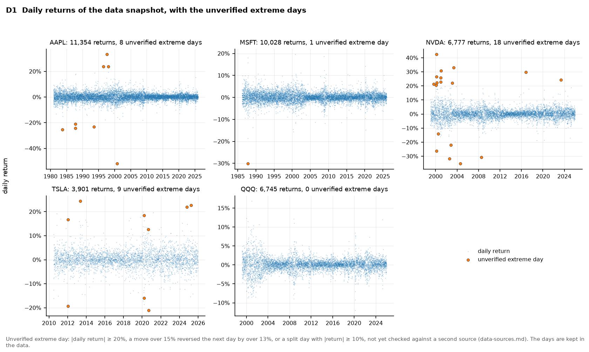

Daily returns of NVDA, AAPL, MSFT, TSLA and QQQ come from Yahoo Finance (snapshot
`full-2026-10-12`), each from its first trading day to 2025-12-31 (D1). The data is partially
checked, not fully verified ([data-sources.md](data-sources.md)): trading dates match the NYSE
schedule and Adj Close is consistent with Yahoo's own dividend records, but no second source has
been compared, and 36 extreme days are **unverified** (NVDA 18, TSLA 9, AAPL 8, MSFT 1, QQQ 0). They
stay in the data and are flagged.

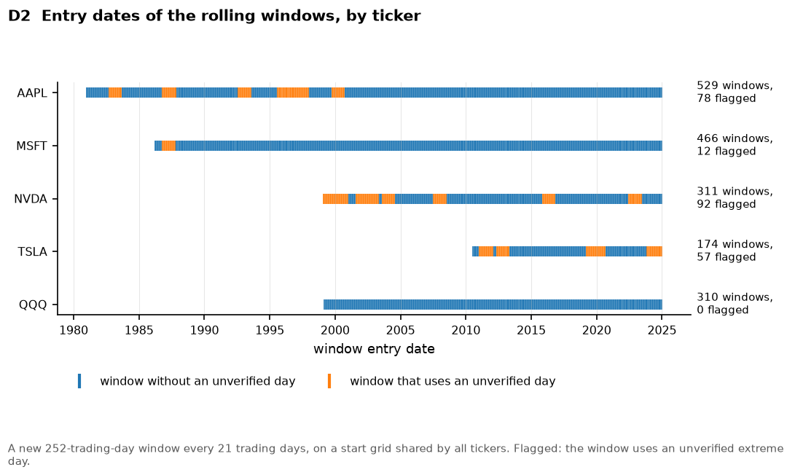

The run of record (`rolling-252-s21-r2`, protocol `20261013T043848Z`) holds 1,790 windows of 252
trading days, a new one every 21 trading days on a start grid shared by all tickers (D2). 239 of
them (13%) use an unverified day, including 30% of NVDA's windows and 33% of TSLA's. Consecutive
windows share most of their days, so they describe one history per ticker, not independent samples.
Every check of the run passed: 46 check tests with no violation on all 1,790 windows, and an
independent Python computation matched all 1,074 paths it compared (spec §8).

## 2. Path dependence (question 1)

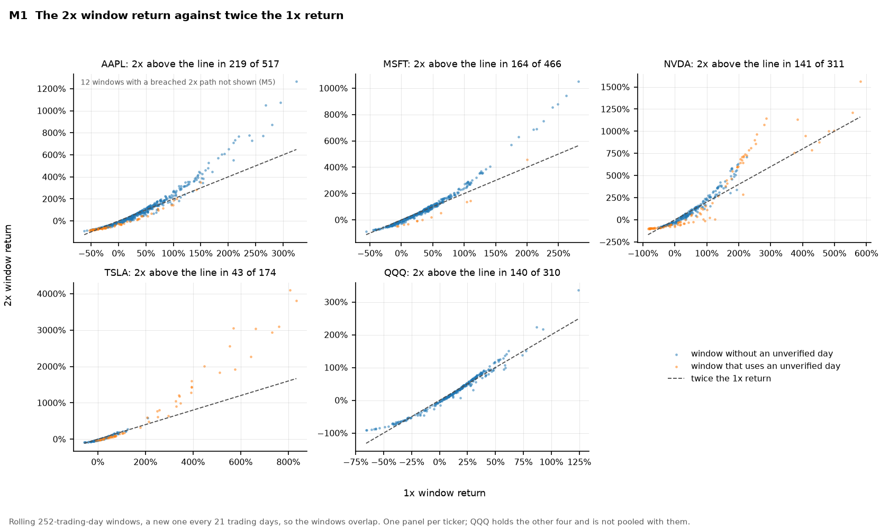

| | AAPL | MSFT | NVDA | TSLA | QQQ |
|---|---|---|---|---|---|
| Windows | 529 | 466 | 311 | 174 | 310 |
| Median 1x return | 24.4% | 22.8% | 39.5% | 22.5% | 16.6% |
| Median 2x return | 35.2% (517 windows) | 39.9% | 51.3% | 13.5% | 31.4% |
| 2x return above twice the 1x return | 219 of 517 (42.4%) | 164 of 466 (35.2%) | 141 of 311 (45.3%) | 43 of 174 (24.7%) | 140 of 310 (45.2%) |

For every ticker, the daily-reset 2x return exceeded twice the 1x return in fewer than half of the
windows (M1). QQQ holds the other four, so it is shown on its own, never pooled with them.

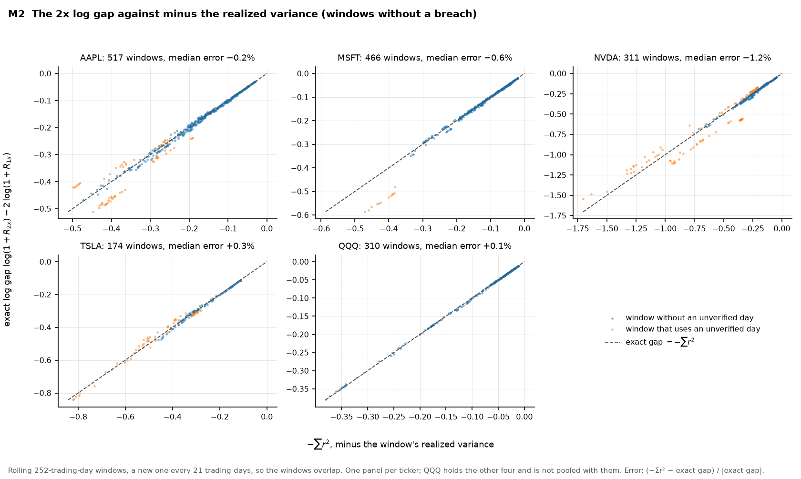

Under the model, the gap to twice the underlying has an exact form. Each day
`(1 + r)² − (1 + 2r) = r²`, so in log terms a 2x window without a breach always falls short of
twice the underlying, by about the window's realized variance:

```text
log(1 + R_2x) − 2 log(1 + R_1x) = Σ log(1 − (r_t / (1 + r_t))²) ≈ −Σ r_t²
```

In simple returns, compounding can still lift the 2x return above twice the underlying's in strong,
steady trends (spec §8, expectation 1). The exact identity held in all 1,778 windows without a
breach. The approximation `−Σ r²` was close: its median relative error per ticker lay between
−1.2% (NVDA) and +0.3% (TSLA) (M2).

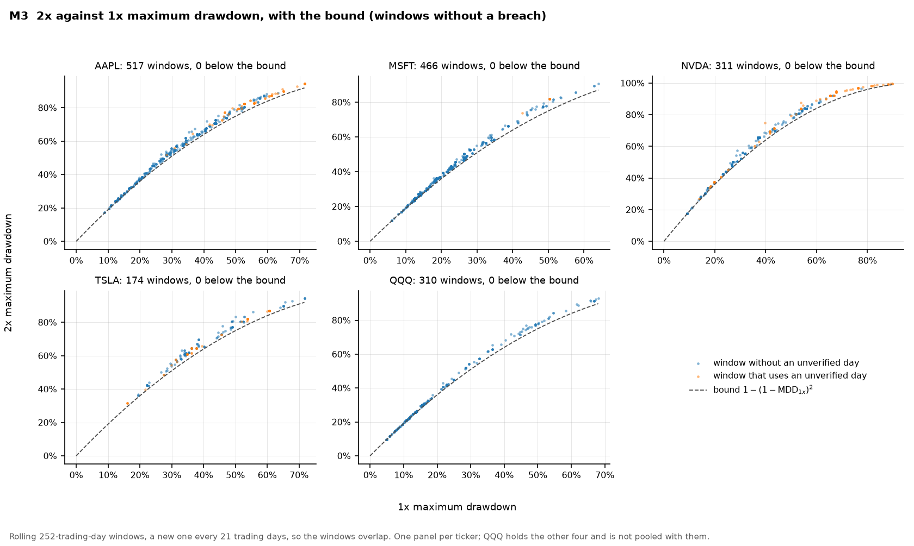

For drawdowns, the model implies `MDD_2x ≥ 1 − (1 − MDD_1x)²` for every window without a
breach: a 30% drawdown at 1x means at least 51% at 2x (spec §8, expectation 2). No window fell
below this bound (M3).

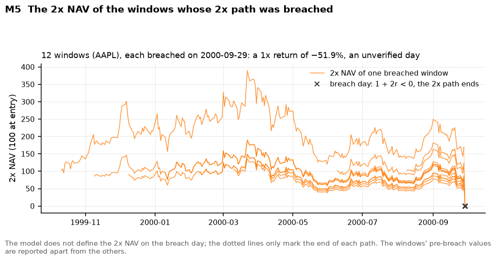

At 2x, only a daily loss of 50% or more ends a path (`1 + 2r ≤ 0`), and the snapshot has one such
day: AAPL on 2000-09-29 (−51.9%), which is unverified. The 12 AAPL windows that contain it have no
2x return; they are left out of the 2x statistics and reported apart, with their values before the
breach (M5). A breach is a model boundary, not a modeled liquidation of a real fund.

## 3. Rebalancing (question 2)

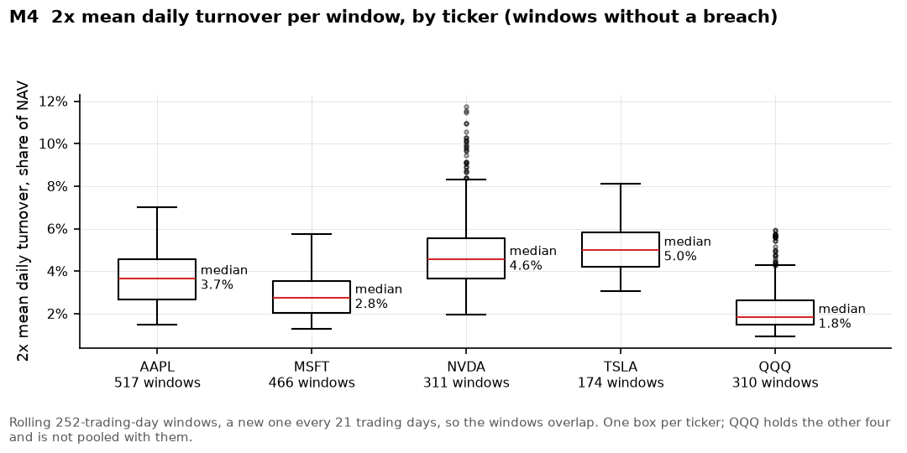

To return to 2x exposure at each close, the model trades `L(L − 1) r = 2r` of the day's starting
NAV, adding exposure after up days and cutting it after down days, so the daily turnover is `2|r|`
(spec §3; §8, expectation 4). The median of the 2x mean daily turnover per window ranged from 1.8%
of NAV (QQQ) to 5.0% (TSLA) (M4). These are magnitudes the model implies, not observed trading or
market impact.

## 4. Sensitivity to the unverified days

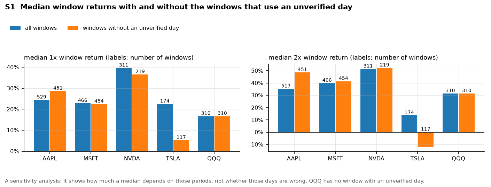

Leaving out the 239 windows that use an unverified day moves some medians noticeably: TSLA's median
2x return falls from 13.5% (174 windows) to −12.3% (117), while AAPL's rises from 35.2% (517) to
48.5% (451); QQQ has no such window (S1). The flagged windows are a non-random subset, periods with
extreme market days, so this shows how much the results depend on those periods, not whether those
days are data errors.

## 5. Spark performance (question 3)

Runtime and memory were measured on one Apple Silicon laptop (8 cores, 8 GiB RAM), with Spark in
local mode, a fresh process per run, and memory as the summed resident memory of the run's
processes, sampled every 0.25 s. Each experiment's design and predictions were committed before any
measured run, and each figure keeps that experiment's own time metric: `wall_s`, or
`wall_excl_capture_s` (the wall time without recording the execution plans) where plans were
recorded.

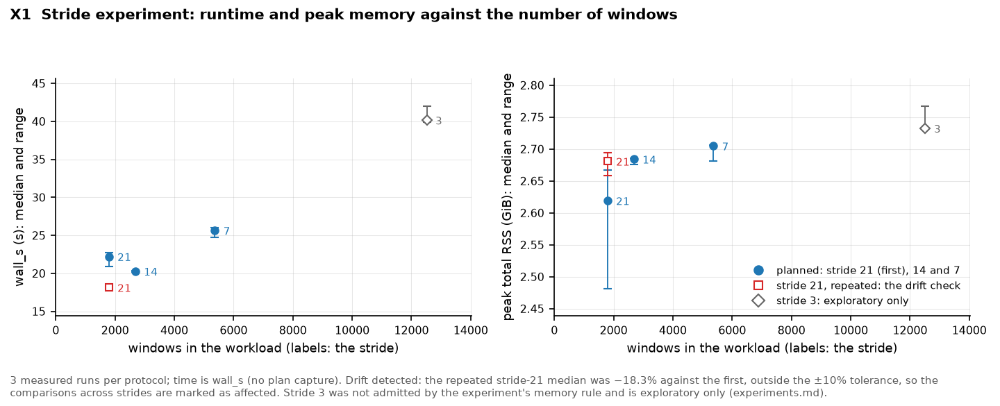

**Workload size** ([experiments.md](experiments.md)). Going from stride 21 to stride 7 (1,790 to
5,364 windows) raised the median `wall_s` from 22.2 to 25.7 s (20.3 s at stride 14) and the median
peak from 2.62 to 2.70 GiB. A linear fit over the three strides gives an intercept of 18.8 s (85% of
the stride-21 median) and 1.2 ms per window: an estimate from three points, not measured overhead.
A repeated stride-21 protocol had an 18.3% shorter median than the first, beyond the 10% drift
tolerance, so the comparisons across strides are marked as affected; stride 3 (40.2 s, 2.73 GiB) is
exploratory only. At stride 21 these runs took half the run of record's time (44.7 s) and about
twice its memory (1.27 GiB); the records do not establish why.

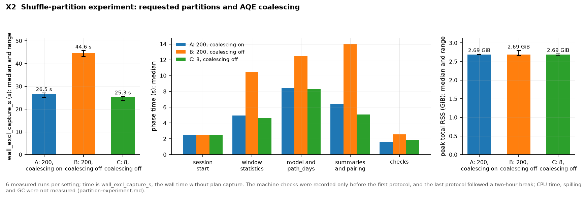

**Shuffle partitions** ([partition-experiment.md](partition-experiment.md), stride 7). The median
`wall_excl_capture_s` was 26.5 s with Spark's defaults (A: 200 shuffle partitions, AQE coalescing
on), 44.6 s with coalescing off (B) and 25.3 s with 8 partitions and coalescing off (C). B's median
was 69% longer than A's and 77% longer than C's, in both halves of the order; A and C showed no
clear difference. In B every shuffle read used all 200 partitions, its summed stage task counts were
3.3 to 19.7 times A's, it wrote 1,584 output files against A's 50, and one join stayed a sort-merge
join where AQE chose a broadcast join in A and C; the records cannot separate these costs. Median
peaks were 2.69 GiB in all three.

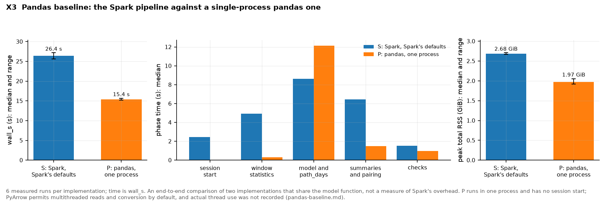

**Spark against pandas** ([pandas-baseline.md](pandas-baseline.md), stride 7). A pandas
implementation of the same computation, running in one process, had a 41.8% shorter median `wall_s`
than the Spark pipeline at Spark's defaults (15.4 against 26.4 s) and a 26.6% lower median peak
(1.97 against 2.68 GiB), in both halves of the order; the prediction had put it at about 40 s. Its
model phase took longer (12.1 against 8.6 s), its other phases less time, and it starts no Spark
session. Both call the same model function but read, aggregate and write in their own ways, so this
is an end-to-end comparison of two implementations, not a measure of Spark's overhead. PyArrow
permits multithreaded reads and conversion by default; actual thread usage during the measurements
was not recorded.

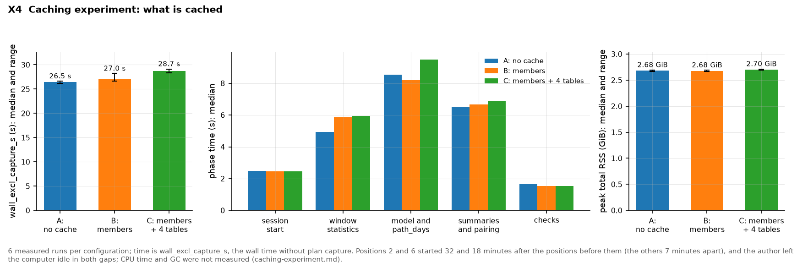

**Caching** ([caching-experiment.md](caching-experiment.md), stride 7). With the window-member rows
cached (B), or those and the four tables read back after each phase (C), the median
`wall_excl_capture_s` was 27.0 and 28.7 s against 26.5 s without a cache (A): B and C were 2.1% and
8.4% slower than A, slower in each half but below the 10% threshold, so there was no clear
difference. Caching the members lengthened the window statistics by 0.93 s and shortened the model
phase by 0.33 s; C's further caches lengthened the model phase by 1.29 s, with no observed net
saving in the summaries or checks. Median peaks were 2.68–2.70 GiB.

## 6. Limitations

- **Data.** One source, partially checked. Until a second source is compared, the 36 unverified
  extreme days may be data errors as well as market events. A same-day re-download differed by up
  to 1.9e−6 in daily returns, and the data's terms of use have not been reviewed
  ([data-sources.md](data-sources.md)).
- **Windows.** Overlapping windows of five tickers describe one history each, not independent
  samples, so no probability statements are made. QQQ holds the other four, all five share
  market-wide shocks, and the four stocks are survivors.
- **Model.** No fees, financing, interest on cash, tracking error or trading costs, and one reset
  at each close, so no NAV here forecasts a real fund; a breach is a model boundary (spec §3).
- **Performance.** One machine, one dataset and Spark's local mode, with three measured runs per
  protocol and six per configuration. RSS sampled every 0.25 s can miss shorter peaks, and summed
  RSS counts shared pages once per process. CPU time, garbage collection and spilling were not
  measured, so the records cannot separate the mechanisms behind the differences. Conditions
  varied: drift in the stride experiment, machine checks only before the first protocol and a
  two-hour break in the shuffle-partition experiment, and uneven gaps in the caching experiment.
- **Figures.** Regenerating them gives byte-identical files only in the same environment: the
  lockfile's packages, matplotlib's bundled fonts and the same platform.

## 7. Conclusions

> **AI-assisted draft for the author's review.** Drafted with Claude Code (Opus 5.5) on 2026-10-23,
> at the author's request, from the findings in sections 1–6 and the documents they cite. The
> author has not yet reviewed or approved it, so it is not yet the author's text.

- **Path dependence (question 1).** For these five tickers, the daily-reset 2x return came out above
  twice the 1x return in fewer than half of the one-year windows: from 24.7% of TSLA's to 45.3% of
  NVDA's. Under the model, the reset costs about the window's realized variance in log terms, so 2x
  comes out ahead only when the compounding of a strong move outweighs that cost. Every window
  without a breach respected the drawdown bound `1 − (1 − MDD_1x)²`.
- **Rebalancing (question 2).** The reset trades twice each day's return, as a share of NAV, so the
  2x path's turnover follows the underlying's volatility: the median of its mean daily turnover per
  window ran from 1.8% of NAV for QQQ to 5.0% for TSLA. These are magnitudes the model implies, not
  observed trading.
- **Data.** Some results depend on the 36 unverified extreme days: without the windows that use
  them, TSLA's median 2x return changes sign. Until a second source confirms those days, results
  that depend on them remain unverified.
- **Spark performance (question 3).** On one laptop, with planned workloads of up to 5,364
  windows, the only setting tried that made a clear difference was turning off AQE's coalescing at
  200 shuffle partitions, which lengthened the median time by 69%; caching made no clear
  difference. Fixed costs appeared to dominate at stride 21 (an intercept estimated at 85% of the
  median, from three points and with drift), and at stride 7 a single-process pandas
  implementation of the same computation was faster end to end and used less memory. These results
  do not show how the pipeline would behave with larger data or on other machines.
- **Scope.** The results describe one history per ticker under a model without fees, financing or
  trading costs; they are neither forecasts nor probabilities for future holding periods.

## 8. The figures

| Figure | Shows | Read from |
|---|---|---|
| [D1](figures/d1-daily-returns.png) | every daily return, with the unverified extreme days | snapshot `full-2026-10-12` |
| [D2](figures/d2-window-entry-dates.png) | each window's entry date, flagged or not | the run's window definitions |
| [M1](figures/m1-returns-2x-vs-1x.png) | 2x against twice the 1x return, per window | run `run-20261013T043848Z-2` |
| [M2](figures/m2-log-gap-vs-variance.png) | the exact 2x log gap against `−Σ r²` | the same run |
| [M3](figures/m3-drawdown-bound.png) | 2x against 1x maximum drawdown, with the bound | the same run |
| [M4](figures/m4-turnover-2x.png) | 2x mean daily turnover per window | the same run |
| [M5](figures/m5-breached-windows.png) | the 2x NAV of the 12 breached windows | the same run |
| [S1](figures/s1-sensitivity-medians.png) | medians with and without the flagged windows | the same run |
| [X1](figures/x1-stride-experiment.png) | `wall_s` and peak memory by workload | [stride-experiment.csv](measurements/stride-experiment.csv) |
| [X2](figures/x2-shuffle-partition-experiment.png) | `wall_excl_capture_s`, phases and peaks by setting | [shuffle-partition-experiment.csv](measurements/shuffle-partition-experiment.csv) |
| [X3](figures/x3-pandas-baseline.png) | `wall_s`, phases and peaks of Spark and pandas | [pandas-baseline.csv](measurements/pandas-baseline.csv) |
| [X4](figures/x4-caching-experiment.png) | `wall_excl_capture_s`, phases and peaks by cache | [caching-experiment.csv](measurements/caching-experiment.csv) |

The four runs of the run of record's protocol have the same table contents (checked on 2026-10-22,
when the figures were made); the figures read run 2. `uv run --group plots python -m etf_risk.plots`
writes all twelve figures into `docs/figures/`, with [figures.json](figures/figures.json), which
records each input's SHA-256 and each figure's checked numbers. With `--check` it draws nothing and
compares those numbers with the values reported in spec §8, data-sources.md and the experiment
documents. X1–X4 read the reviewed copies of the measurement CSVs in
[measurements/](measurements/README.md), so they can be redrawn and checked from a fresh clone; the
other eight figures need the data under `data/`, which is not in Git. [demo.md](demo.md) walks
through all of this, the SQL analyses and a small pipeline run.
