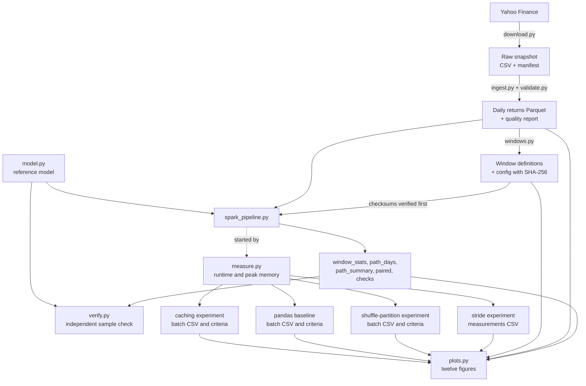
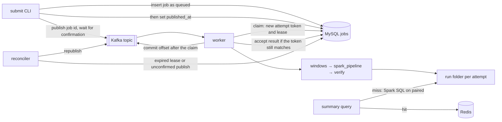

# Leveraged ETF Risk Analytics — specification

Last updated 2026-10-23. Implemented: the pipeline, three Spark SQL analyses of
its results, a Docker image, the stride experiment
([experiments.md](experiments.md)), the shuffle-partition experiment
([partition-experiment.md](partition-experiment.md)), the pandas baseline
([pandas-baseline.md](pandas-baseline.md)), the caching experiment
([caching-experiment.md](caching-experiment.md)), and the figures, results
write-up and demo of Stage 4 ([results.md](results.md), [demo.md](demo.md)); in
progress: an optional systems extension with MySQL, Kafka and Redis (§11), of
which the job queue exists: the job table, Kafka delivery and the reconciler
([job-table.md](job-table.md), [job-queue.md](job-queue.md)), and a worker that runs
the real pipeline under a watchdog and a host execution lock
([worker-pipeline.md](worker-pipeline.md)). The recovery study is documented
([recovery-part-a.md](recovery-part-a.md), [recovery-part-b.md](recovery-part-b.md)):
E1 has supporting correctness observations, and valid formal E2 recovery-time
evidence remains outstanding.
Every section separates what is **implemented** from what is **planned**.
Planned parts describe intentions, not results, and may change when each stage
is reviewed.

| Stage | Scope | Status |
|---|---|---|
| Prototype | Reference model; Spark run over one full-period path per ticker and leverage; Python/Spark consistency checks; 2020–2025 data | **Implemented** (now expressed as full-period windows) |
| Stage 1 | Full-history download, checksum-enforced ingestion, data validation, [data-sources.md](data-sources.md) | **Implemented** |
| Stage 2 | Fixed 252-trading-day holding windows, with the Spark grouping keys, 1x/2x pairing, breach end dates and reference check reworked together; a first sparse-stride run with measured runtime and memory | **Implemented**, including the review cleanup; stride-21 run reviewed |
| Stage 3 | Spark SQL analysis of the results, a reproducible environment (Docker) and performance experiments | **Implemented**: three SQL analyses, the Docker image, the stride experiment ([experiments.md](experiments.md)), the shuffle-partition experiment ([partition-experiment.md](partition-experiment.md)), the pandas baseline ([pandas-baseline.md](pandas-baseline.md)) and the caching experiment ([caching-experiment.md](caching-experiment.md)) |
| Extension (optional) | Job queue (MySQL job table, Kafka), result cache (Redis), Docker Compose; recovery and caching experiments (§11) | **In progress**: the job queue: the MySQL job table, Kafka delivery and the reconciler ([job-table.md](job-table.md), [job-queue.md](job-queue.md)), and a worker running the real pipeline ([worker-pipeline.md](worker-pipeline.md)); the recovery study documented ([recovery-part-a.md](recovery-part-a.md), [recovery-part-b.md](recovery-part-b.md)): E1 has supporting correctness observations, and valid formal E2 recovery-time evidence remains outstanding; the Redis result cache ([result-cache.md](result-cache.md)) and its experiment E3, with one valid formal batch ([result-cache-experiment.md](result-cache-experiment.md), [result-cache-part-b.md](result-cache-part-b.md)) |
| Stage 4 | Figures, final documentation and demo | **Implemented**: twelve figures drawn from the result files by `plots.py` and checked against the documented values, with the measurement CSVs of X1–X4 committed ([measurements/README.md](measurements/README.md)); the results write-up, whose conclusions the author approved ([results.md](results.md)); the demo ([demo.md](demo.md)) |

## 1. Purpose and scope

This independent project studies how a fund that resets to a fixed multiple of
its underlying every trading day behaves over a holding period: its return
compared with the underlying, its drawdowns, and the rebalancing the daily
reset implies. It replays the model on historical daily returns of NVDA, AAPL,
MSFT, TSLA and QQQ, and uses Spark to run many holding windows in batch.

Out of scope: forecasting any real ETF's NAV (fees, financing and execution are
ignored), estimating the market impact of rebalancing, and probability
statements about future returns. Results describe historical windows of a few
tickers.

Course concepts applied: a Python reference implementation with tests; Parquet
with explicit schemas (PyArrow); PySpark batch processing with grouped pandas
functions; Spark DataFrame aggregation and three Spark SQL analyses; performance
measurement (a stride experiment, a shuffle-partition experiment and a pandas
baseline); a Docker image for the pipeline.
An optional systems extension (§11) explores a job queue and a result cache
around the pipeline; nothing in the analysis depends on it.

## 2. Research questions

1. **Path dependence.** Over the same fixed holding period, how does the path of
   the underlying's daily returns shape the result of a daily-reset 2x model,
   compared with the underlying itself and with twice its return?
2. **Rebalancing.** Under the model's assumptions, how large is the exposure
   adjustment the daily reset requires, relative to NAV, and how does it depend
   on leverage and the day's return? Dollar amounts scale linearly with NAV, so
   results are given per unit of NAV; a hypothetical fund size only rescales them.
3. **Spark performance.** How do workload size, partitioning and caching affect
   Spark runtime and memory for this workload on one machine, and why?

Engineering questions for the optional systems extension (job processing,
recovery, result caching) are in §11; they concern the infrastructure around
the pipeline, not the analysis.

## 3. Model — implemented (`src/etf_risk/model.py`)

With `r_t` the underlying's simple return on day `t`, `L` the daily target
leverage and `V_(t-1)` the NAV at the start of day `t`:

```text
V_t               = V_(t-1) × (1 + L × r_t)
exposure_before_t = L × V_(t-1) × (1 + r_t)     end of day, before the reset
exposure_target_t = L × V_t                     after the reset
rebalance_t       = exposure_target_t − exposure_before_t = L × (L − 1) × V_(t-1) × r_t
```

A positive rebalance adds exposure, a negative one cuts it. It is a
model-implied amount, not observed trading.

**Assumptions**

- The fund holds exposure `L × V_(t-1)` during day `t`, does not trade intraday,
  and resets to `L × V_t` at the close.
- Underlying returns are total returns (computed from Adj Close, so dividends
  are reinvested).
- No fees, financing costs, interest on cash, creations or redemptions, taxes,
  tracking error or trading costs, so the NAV is not a forecast of any real ETF.
- `L > 0` (no inverse funds). Every path starts at NAV 100, and NAV carries over
  from day to day.
- Invalid input raises an error and is never treated as a breach: returns must
  be finite and at least −100%, and `L` and the starting NAV must be finite and
  positive.

**Breach rule.** If `1 + L × r_t ≤ 0`, the NAV would reach zero or go negative,
which the model cannot represent. Day `t` is recorded with status `breach`, NaN
NAV, NaN target exposure and NaN rebalance, and the path stops; later days are
not output, so a breached path is shorter than its input. The path summary
reports `breached`, `breach_day`, and NaN `final_nav` and `total_return`;
drawdown and rebalance metrics cover the days before the breach. A breach is a
model boundary, not a modeled liquidation of a real product. For `L = 2` it
requires a daily return of −50% or worse.

**Per-day output**: `day, daily_return, nav_start, nav, exposure_before,
exposure_target, rebalance, status, running_peak, drawdown`. The running peak
includes the starting NAV, and `drawdown_t = 1 − V_t / running_peak_t`.

**Path summary** (`summarize_path`): `days_ok, breached, breach_day, final_nav,
total_return, max_drawdown, total_abs_rebalance, max_abs_rebalance`.

**Normalized rebalancing (implemented in Stage 2, computed in Spark; `model.py`
unchanged)**: daily turnover `|rebalance_t| / V_(t-1)`, a fraction of that day's
starting NAV and so not biased by NAV growth (model identity `L(L−1)|r_t|`, exactly
0 at 1x). Per path, over the days before any breach: mean, maximum (with the
earliest date of the maximum) and total turnover, each stored with its day
count. Per window, from the returns alone: realized variance `Σ r_t²` and the
exact gap `Σ log(1 − (r_t/(1+r_t))²)`, both null unless every term is valid.
Dollar rebalance sums stay only for the reference comparison.

## 4. Data inputs and outputs

### Implemented

| Artifact | Location (gitignored unless marked) | Produced by | Contents |
|---|---|---|---|
| Raw snapshot | `data/raw/yahoo/<snapshot>/` | `download.py` | one CSV per ticker (Date, Open, High, Low, Close, Adj Close, Volume, Dividends, Stock Splits; QQQ also has Capital Gains, all zero in `full-2026-10-12` and unused) and `manifest.json` (download time, tool versions, request settings, rows, dates, SHA-256 per file); the prototype snapshot sits in `data/raw/yahoo/` with `verification.json` |
| Daily returns | `data/processed/<snapshot>/daily_returns/<TICKER>.parquet` | `ingest.py` | `ticker` string, `date` date32, `adjusted_price` double, `daily_return` double (null on the first row); schema metadata naming the source, snapshot and checksums |
| Quality report | `data/processed/<snapshot>/quality_report.json` | `ingest.py` | per-ticker check results, a verification-status block, and the list of unverified extreme days |
| Window definitions | `data/windows/<snapshot>/<name>/` (`windows.parquet`, `config.json`) | `windows.py` | one row per window: `window_kind, ticker, window_days, entry_date, first_return_date, exit_date, entry_row, stride, calendar_year, contains_unverified_day, unverified_day_count, entry_on_unverified_day`; the config records the SHA-256 of every return file, of `quality_report.json` and of `windows.parquet`, the self-check results, the flag rule, each return file's raw-manifest hash, and the code that built it (commit, whether the worktree was clean, SHA-256 of every source file and of `uv.lock`) |
| Run output | `data/outputs/windows/<snapshot>/<name>/<run id>/` | `spark_pipeline.py`, `verify.py` | `window_stats/` (one row per window, no model), `path_days/` (per window, leverage and day; partitioned by ticker), `path_summary/` (per window and leverage), `paired/` (per window, 1x and 2x; for a breached 2x path the full-window 2x drawdown and turnover columns are null and the partial values sit in `*_pre_breach` columns with `days_ok_2x`), `checks.json`, `run.json` (including the code provenance and the JVM's measured maximum heap), and `verify.json` from the sample check |
| Measurement records | `data/outputs/windows/<snapshot>/<name>/protocol-<UTC time>.json`, `<run id>.log` (the stride experiment: under `data/outputs-experiments/`) | `measure.py` | per run: wall time, in-process phase timings, peak summed RSS in total and per process type, stop-rule status and its limits; since 2026-10-23 also the process types' rule (`process_kinds`), under which a Java process is `spark_jvm` only if its command line runs Spark |
| Measurements CSV | `data/outputs-experiments/measurements.csv` | `analysis/collect_measurements.py` | one row per started run of the stride experiment: identity and role, input size, Spark settings, summed stage task counts, wall and phase times, peak RSS by process type, sampling, code ([experiments.md](experiments.md) 5.6) |
| Execution plans | `plans.json` in a run folder | `spark_pipeline.py --record-plans` (`plans.py`) | for every SQL execution of the run: its phase and final plan text, each shuffle exchange's requested and runtime partition counts, each AQE shuffle read's mark and partition count ([partition-experiment.md](partition-experiment.md) 4.2); in format 2, also each execution's description and scan nodes ([caching-experiment.md](caching-experiment.md) 4.2) |
| Shuffle-partition batch | `data/outputs-partitions/<batch>/` | `measure.py` through `docs/partition-session.zsh`; `analysis/collect_partition_measurements.py` | protocols and runs of configurations A, B and C, `positions.tsv`, `run-log.txt`, and the collector's `measurements.csv` and `acceptance.json` ([partition-experiment.md](partition-experiment.md) 2.4, 4.3) |
| Pandas-baseline batch | `data/outputs-baseline/<batch>/` | `measure.py --pipeline` through `docs/baseline-session.zsh`; `analysis/collect_baseline_measurements.py` | protocols and runs of S (the Spark pipeline) and P (the pandas pipeline), `positions.tsv`, `run-log.txt`, and the collector's `measurements.csv` and `acceptance.json` ([pandas-baseline.md](pandas-baseline.md) 2.4, 4.3) |
| Caching batch | `data/outputs-caching/<batch>/` | `measure.py` through `docs/caching-session.zsh`; `analysis/collect_caching_measurements.py` | protocols and runs of configurations A, B and C (`spark_pipeline --cache`), `positions.tsv`, `run-log.txt`, and the collector's `measurements.csv` and `acceptance.json` ([caching-experiment.md](caching-experiment.md) 2.4, 4.3) |
| Figures | `docs/figures/` (committed) | `plots.py` | twelve PNGs (M1–M5, S1, D1–D2, X1–X4) and `figures.json`: each input's path and SHA-256, and each figure's checked numbers ([results.md](results.md) 8) |
| Measurement CSV copies | `docs/measurements/` (committed) | copied from the four collectors' outputs | reviewed copies of the experiments' measurements CSVs, which X1–X4 read ([measurements/README.md](measurements/README.md)) |

Snapshots: `full-2026-10-12` (five tickers, each from its first trading day to
2025-12-31; used for the main analysis) and the 2020–2025 snapshot of the four
stocks (prototype only). Settings, checksums and limitations are recorded in
[data-sources.md](data-sources.md).

**Data status: partially checked, not fully verified.** Trading dates match the
NYSE schedule from pandas_market_calendars; Adj Close is consistent with Yahoo's
own dividend records; none of the 23 split-day returns resembles an unadjusted
split, which does not prove that every split adjustment is correct. No second
source has been compared, the terms of use have not been reviewed, and **36
extreme days are unverified**, including AAPL 2000-09-29 (−51.9%).

### Planned

None: the figures, planned here until Stage 4, are listed above. They are
generated from the result files and never edited by hand.

## 5. Module hierarchy and data flow

```text
src/etf_risk/
  download.py        implemented  Yahoo Finance -> raw snapshot + manifest (network; "download" dependency group)
  ingest.py          implemented  raw snapshot -> validated daily returns (Parquet) + quality report
  validate.py        implemented  data checks used by ingest (pure functions)
  model.py           implemented  sequential reference model for one path
  windows.py         implemented  window definitions and their checksums; verify_checksums() for later steps
  spark_pipeline.py  implemented  window members, model per window, Spark summaries, 1x/2x pairing, full-scale checks,
                                  optional caches (--cache)
  verify.py          implemented  sample check against an independent Python slicing of each window
  measure.py         implemented  fresh-process timed runs, process-tree memory sampling, stop rule
  provenance.py      implemented  code state for every record (commit, worktree state, SHA-256 of uv.lock and of every module
                                  and SQL schema under src/etf_risk/, jobs/ included, by package-relative path, since
                                  2026-10-23; earlier records hash the top-level modules only); repo-relative paths
  plans.py           implemented  a run's final execution plans, AQE partition counts, descriptions and scan nodes
                                  (spark_pipeline --record-plans)
  pandas_pipeline.py implemented  the pipeline's results in one process with pandas, without Spark (the pandas baseline)
  plots.py           implemented  the twelve figures from result files, checked against the documented values (Stage 4)
  jobs/              implemented  optional job queue (§11): job table schema (MySQL, SQLite mirror), guarded state
                                  transitions (store.py), MySQL and Kafka adapters, worker and its consume loop,
                                  reconciler; the real pipeline (pipeline.py) with its launcher's watchdog and host
                                  lock (launcher.py, processes.py), job parameters, time settings, event logs, the
                                  commands (python -m etf_risk.jobs); simulated pipeline and in-memory queue
  runs.py            implemented  a run folder's manifest and run digest (the accepted result's identity); which runs
                                  the result cache may serve (accepted job runs, the reviewed registry of historical
                                  runs, docs/accepted-runs.json), the folder check, and `register`
  services.py        implemented  the extension's Compose services from this machine: readiness (a MySQL login, Kafka
                                  metadata, a Redis PING), cgroup memory peaks, a count of other projects' containers,
                                  and the result cache's Redis client (no retries, RESP2, no handshake commands)
  cache.py           implemented  the result cache's logic (project author, with tutoring): parameters in canonical
                                  form, the result's identity and key, the stored value, the circuit breaker,
                                  cache-aside get-or-compute with its fallback and counters
  summary.py         implemented  the three SQL analyses as named queries over a run's paired table (their SQL by the
                                  project author), with a ticker-set parameter; one-shot `query` and warm `serve`
  cache_experiment.py implemented the result-cache experiment E3 (Claude Code): the workload, the plan, the keys it
                                  owns, the container, host and own-CPU monitors, the settle, and the driver
analysis/            implemented  three Spark SQL analyses of a run's paired table (project author):
                                  sql_overview.py, sql_comparison.py, sql_sensitivity.py;
                                  collect_measurements.py (with Claude Code): the stride experiment's measurements CSV;
                                  collect_partition_measurements.py (Claude Code): a shuffle-partition batch's CSV and criteria;
                                  collect_baseline_measurements.py (Claude Code): a pandas-baseline batch's CSV and criteria;
                                  collect_caching_measurements.py (Claude Code): a caching batch's CSV and criteria;
                                  collect_result_cache_measurements.py (Claude Code): an E3 batch's checks, paired
                                  results with the swap-out sensitivity analysis, and host diagnostics
tests/               implemented  model, validation, ingest, download, windows, Spark consistency and failure
                                  injection, sample check, measurement, provenance, AI-log tooling, partition
                                  flags, plan recording, the partition collector and session helpers, the pandas
                                  pipeline against the Spark pipeline, the baseline collector and session helpers,
                                  the caching option, the caching collector and session helpers, the job table,
                                  worker, queue and reconciler (on SQLite; on MySQL and Kafka when configured), the
                                  services helper, and the job queue's mutation checks (tests/mutation_check.py)
.claude/hooks/       implemented  per-message AI-usage logs with redaction (project tooling, not analysis)
Dockerfile, docker/  implemented  pipeline image and its build and run scripts (data mounted, never copied in);
                                  compose.yaml with the extension's services (MySQL, Kafka and Redis)
```



Every box is implemented.
`measure.py` starts each timed `spark_pipeline.py` run as a fresh process.

Inside `spark_pipeline.py`: every SHA-256 in the window config is verified
before Spark starts. Each definition is exploded into its member rows
(`entry_row + 1 … entry_row + window_days`) and joined to a broadcast of the
returns (about 39k rows). `groupBy(window key).applyInPandas` sorts each window
by date, raises if it does not have exactly `window_days` rows with unique
dates, and runs `model.simulate_path` for every leverage on the same returns,
so 1x and 2x always share their input. Path summaries are computed with Spark
aggregations rather than by calling `summarize_path`, so comparing the two
(`verify.py`) is a real check; 1x and 2x are paired by conditional aggregation
on the window key. Each table is written and read back, so the model runs once
per window.

## 6. Validation approach

### Implemented

- **Data (Stage 1)**: checksum of every raw file against its manifest; duplicate
  dates and invalid prices or volumes are errors; trading calendar compared with
  the NYSE schedule, each ticker only within its own date range, where a session
  without a row or a row on a non-session day is an error and market closures
  are listed; split-day returns compared with what an unadjusted split would
  show; dividend steps compared with Yahoo's reported dividends; zero-volume rows
  and rows without an intraday range reported; extreme days listed as
  unverified. What each check does not establish is stated in
  [data-sources.md](data-sources.md).
- **Model**: hand-calculated cases in `tests/test_model.py` (zero returns, a
  single up or down day, two up days, a round trip that loses value at 2x, the
  starting NAV as a drawdown peak, the rebalance closed form, no rebalancing at
  1x, a breach on day 2, exactly −50% at 2x as a breach, invalid inputs).
- **Provenance**: ingest refuses a raw file whose SHA-256 differs from its
  manifest; the window config records the SHA-256 of every return file, of
  `quality_report.json` and of `windows.parquet`, and `spark_pipeline.py` and
  `verify.py` refuse to run if any of them changed. Window configs, run records,
  protocol files and `verify.json` record the code that produced them: the git
  commit, whether the worktree was clean, and the SHA-256 of every source file
  and of `uv.lock`, so results from uncommitted code remain identifiable. The
  Docker image has no `.git`: there the commit and clean flag come from the
  build (`code_source: "build"`) and the image ID is recorded as well.
- **Definition self-check (`windows.py`)**: before writing, every window is
  re-derived from the returns: the dates at its entry, first-return and exit
  rows, the start grid and 21-session spacing, complete coverage of all grid
  starts, calendar-year sessions, and the unverified flags. Any violation stops
  the build; the counts are stored in the config.
- **Full-scale checks in Spark (Stage 2, every run)**, written to `checks.json`;
  any violation gives exit code 1:
  1. window construction: member rows per window equal `window_days`; first and
     last member dates equal `first_return_date` and `exit_date`; the price rows
     at `entry_row` and `entry_row + window_days` carry `entry_date` and
     `exit_date` (checked before the model runs; a violation stops the run);
  2. complete paths: rows equal `window_days`, or `breach_day` for a breached
     path; days numbered 1 to rows; `days_ok` consistent;
  3. pairing: exactly one summary row per window and leverage, and every
     definition present in `paired`;
  4. 1x identity: the model's 1x total return equals exit price ÷ entry price − 1
     (rtol 1e−9);
  5. exact log gap: for every 2x window without a breach, the model's gap
     `log(1 + R_2x) − 2 log(1 + R_1x)` equals `Σ log(1 − (r/(1+r))²)` computed
     from the returns alone (abs tol 1e−9);
  6. drawdown bound: `MDD_2x ≥ 1 − (1 − MDD_1x)²` for every 2x window without a
     breach;
  7. NAV sanity: no negative NAV; NaN NAV only on breach rows;
  8. turnover identity: daily turnover equals `L(L−1)|r|` before any breach, and
     is exactly 0 at 1x;
  9. every breached window is flagged as containing an unverified day;
  10. null rule, in both directions: every count-guarded value is null exactly
      when its count of valid terms is short (26 tests across `window_stats`,
      `path_summary` and `paired`), so `exact_gap`, `log_gap`, `return_2x`,
      `mdd_bound` and the full-window 2x drawdown and turnover are null exactly
      for breached windows, and the `*_pre_breach` values exist only for them.
- **Sample check (`verify.py`)**, a separate command never run inside timed
  runs: every window of one ticker (default AAPL), every breached window as
  found by Spark or by Python, and the first and last window of each ticker.
  Spark filters to the sample before collecting; Python slices each window from
  its own sorted returns by locating `entry_date` (not through `entry_row`) and
  compares summaries, dates and paired values (`rtol = atol = 1e−9`).
- **Tests**: shuffled input and 1, 3 or 7 partitions give the same summaries;
  every synthetic window matches the independent Python slicing; a breached
  window keeps its scheduled `exit_date`; full-period windows reproduce the
  prototype. Failure injection: a dropped return row stops the run before the
  model, a changed price breaks the 1x identity, a duplicated leverage row
  breaks pairing, a changed input file stops the run before Spark starts, and a
  day with `1 + 2r ≤ 0` gives a null `exact_gap`, never a partial sum.
- **Limits of these checks**: Spark and the Python reference share
  `simulate_path`, so their agreement cannot reveal an error in the model
  itself; the hand-calculated cases and the model identities (checks 5, 6 and 8)
  cover that. The identities compare the model's output with formulas over the
  **same** member rows, so they cannot show that a window holds the right dates
  or that the data is right: a window holding the wrong days would still satisfy
  them, and the 1x identity also holds when prices and returns are shifted
  together. Window dates are checked only by the construction check (check 1),
  the definition self-check and the independent slicing in `verify.py`. Data
  errors that are internally consistent are not detected without a second
  source.

The tests in `tests/` cover the model, data validation, ingest, download (with
a fake fetch function), window definitions, Python/Spark consistency and
failure injection, the sample check, measurement, the AI-log tooling, the
shuffle-partition flags, plan recording, collector and session helpers, and the
pandas pipeline (every table and check against the Spark pipeline's), the
baseline collector and its session helpers; none uses the network. Run them
with `uv run --group measure pytest`.

## 7. Fixed 252-trading-day windows — implemented (Stage 2)

- **Definition.** A window is 252 consecutive daily returns of one ticker (253
  prices). The entry is the close on `entry_date`, the price date before the
  first return; the exit is the close on `exit_date`, the last return date.
  Fixing the number of trading days keeps holding periods comparable; the
  calendar length is about one year and varies with holidays and closures.
- **Rolling windows** (main analysis). A window starts where its first return
  date is an NYSE session whose index, counted from the anchor session
  1980-01-02, is a multiple of `stride`, so all tickers' windows start on the
  same dates. Only complete windows are kept. Strides below 21 are refused
  unless `--allow-dense-stride` is given; strides 14, 7 and 3 were run in the
  stride experiment ([experiments.md](experiments.md)), and daily-start windows
  (stride 1) have not been attempted.

  | Stride | Windows (5 tickers) | Path-day rows at 1x and 2x | Status |
  |---|---|---|---|
  | 21 | 1,790 (AAPL 529, MSFT 466, NVDA 311, QQQ 310, TSLA 174) | 900,714 (breached 2x paths stop early) | run and measured (section 8) |
  | 14 | 2,683 | 1,350,000 | measured in the stride experiment |
  | 7 | 5,364 | 2,698,866 | measured in the stride experiment |
  | 3 | 12,518 | 6,298,446 | measured in the stride experiment, as exploratory only (not admitted by its memory rule) |
  | 1 | 37,550 | at most 18,925,200 | not attempted; memory and runtime not inferred from these counts |

  **Unverified-day flag (conservative rule change in the Stage 2 cleanup).** A
  window is flagged when any date whose closing price it uses, `entry_date`
  through `exit_date`, is an unverified extreme day. The first rule counted only
  return dates (`first_return_date` to `exit_date`) and missed windows entered at
  the close of an unverified day, although their entry price comes from that
  close; `entry_on_unverified_day` marks those. At stride 21 this flags 239 of
  1,790 windows (AAPL 78, MSFT 12, NVDA 92, QQQ 0, TSLA 57), one more than the
  first rule (TSLA, entered 2012-01-17). The flag is used for a sensitivity
  analysis; it does not mean the data is wrong.
- **Calendar-year windows** (labeled supplement). Entry at the ticker's close on
  the previous year's last session; complete years only: 151 ticker-years
  (AAPL 45, MSFT 39, NVDA 26, QQQ 26, TSLA 15; each ticker's first, partial year
  is skipped and recorded). Their lengths vary (2001, for example, lost four
  sessions after 9/11), so they are kept in a separate table and never mixed
  with the fixed-length windows.
- **Keys and pairing.** Window key `(window_kind, ticker, window_days,
  entry_date)`, and path key that plus `leverage`; `window_kind` keeps the
  rolling, calendar-year and full-period tables from ever colliding. 1x and 2x
  use the same window definitions and are compared in one row per window by
  conditional aggregation on the window key, replacing the prototype's
  ticker-only join.
- **End dates.** The scheduled `exit_date` comes from the window definition. A
  breached path ends early, so its `last_ok_date` and `breach_date` are reported
  separately; pairing and joins never use the actual end dates.
- **Null rule.** Spark's `sum`, `avg`, `min` and `max` skip nulls, so every
  aggregate is stored with the count of terms it used and is null unless that
  count is complete. For breached paths, `final_nav`, `total_return`, `log_gap`
  and `exact_gap` are null. Their drawdown and turnover cover only the days
  before the breach: in `paired` they are stored only in `*_pre_breach` columns,
  with `days_ok_2x`, while the full-window columns are null, so they cannot enter
  distribution statistics by accident.
- **Reporting rules.** Results are reported per ticker; any pooled figure is
  labeled as pooled, and QQQ, which holds the other four tickers, is not pooled
  with them. Overlapping rolling windows are described as overlapping, and the
  non-overlapping windows are descriptive observations, not independent
  samples. No probability or confidence statements are based on window counts.

## 8. Expected results

These are expectations derived from the model, written down before the Stage 2
runs so the results can be checked against them rather than fitted afterwards.

1. **Path dependence (question 1).** Each day, `(1 + r)² − (1 + 2r) = r²`, so for
   a 2x window without a breach the log-return gap is exactly

   ```text
   log(1 + R_2x) − 2 × log(1 + R_1x) = Σ log(1 − (r_t / (1 + r_t))²)  ≤ 0
                                      ≈ −Σ r_t²   (realized variance; error of order Σ r_t³)
   ```

   In log terms the 2x model always falls short of twice the underlying, by about
   the window's realized variance. In simple returns it can still beat twice the
   underlying's return in strong, steady trends, because compounding adds
   `R_1x²`, and it falls short in volatile windows without a trend. Checked so
   far only outside the pipeline, on the 2020–2025 prototype data: the exact
   identity matches the model output to about 1e−15 on all four full-period
   paths, and the approximation is within 5% of the exact gap in 18 of 20
   non-overlapping 252-day blocks; the largest difference, 13.8% for NVDA in
   2023, comes from a block with a +24.4% day.
2. **Drawdowns.** Each day `1 + L r ≤ (1 + r)^L` for `L ≥ 1` (Bernoulli's
   inequality). Over the interval from the 1x path's peak to its trough, the
   leveraged NAV therefore ends at no more than `(1 − MDD_1x)^L` times its value
   at the start of that interval. For every window without a breach,
   `MDD_2x ≥ 1 − (1 − MDD_1x)²`: a 30% drawdown at 1x implies at least 51% at 2x.
   The four prototype paths satisfy this (NVDA: 1x 66.3%, bound 88.7%, 2x 92.1%).
3. **Breaches.** At 2x only a day of −50% or worse causes a breach. In
   `full-2026-10-12` the only such day is AAPL 2000-09-29 (−51.9%, unverified),
   so breached 2x windows are expected only among AAPL windows that include it,
   and every result about them will be labeled unverified.
4. **Rebalancing (question 2).** Under the model, the rebalance as a fraction of
   that day's starting NAV is exactly `L(L − 1) r_t`: for 2x, twice the day's
   return, adding exposure after up days and cutting it after down days. Daily
   turnover is therefore `2 |r_t|`, and its distribution per ticker is that of
   `|r_t|` rescaled. The results will report magnitudes, not market impact. The
   largest values fall on extreme days, which are unverified.
5. **Spark performance (question 3).** These are hypotheses to test, not
   findings. At sparse strides, fixed costs (starting the Spark session and the
   Python workers) should dominate. Larger workloads should take longer roughly
   in proportion to the number of windows. Expanding returns into windows
   multiplies the rows Spark has to shuffle by about `252 / stride`, and running
   one grouped pandas call per window adds a per-window Python cost. Spark's
   adaptive execution may merge shuffle partitions, so requested and actual
   partition counts will both be recorded. A single-process pandas run may be
   faster at these sizes. Memory will be measured, not estimated. At the time
   these expectations were recorded, the only timing available was an informal
   prototype run. The subsequent measurements and their limitations are
   reported below.

### What the stride-21 run showed (`full-2026-10-12`, after the cleanup)

Descriptive facts from one configuration, not findings about markets. The rolling
windows overlap. Run of record: `rolling-252-s21-r2`, protocol
`20261013T043848Z` (code with uncommitted changes, identified by its source
checksums in every record).

- **Checks.** All 46 check tests (ten checks) passed with no violation on 1,790
  windows, so the exact log-gap identity (expectation 1) and the drawdown bound
  (expectation 2) held in every one of the 1,778 windows without a breach. These
  identities test the model against the same member rows; window dates rest on
  check 1, the definition self-check (no violation) and `verify.py`. The sample
  check compared 1,074 paths in 537 windows with no mismatch, and Python and Spark
  found the same 12 breached windows. The calendar-year supplement (151 windows)
  and the full-period regression on the prototype snapshot also passed; the
  regression reproduced the prototype's results exactly.
- **Breaches (expectation 3).** Exactly 12 rolling windows breach at 2x, all AAPL
  windows containing 2000-09-29, plus the calendar year AAPL 2000; all are
  flagged unverified and listed separately with their pre-breach values.
- **Approximation.** Over each ticker's windows without a breach (flagged windows
  included), the median relative error of `−Σr²` against the exact gap lies
  between −1.2% (NVDA) and +0.3% (TSLA), with interquartile ranges between −4.3%
  and +2.5%.
- **Turnover (expectation 4).** The median of the 2x mean daily turnover per
  window ranges from 1.8% of NAV (QQQ) to 5.0% (TSLA); breached windows excluded.
- **Sensitivity to unverified days.** Leaving out the 239 flagged windows moves
  some medians noticeably (TSLA 2x return +13.5% across all 174 windows, −12.3%
  across the 117 unflagged ones). This shows how much results depend on periods
  with extreme market days; it is not evidence that those days are data errors.
- **Runtime and memory (expectation 5).** Measured on one machine and
  configuration only: an Apple Silicon laptop (8 cores, 8 GiB RAM), Spark in
  local mode with default settings; other machines and settings have not been
  measured. 900,714 path-day rows from 451,080 window-member rows. Over three
  measured fresh-process runs after one warm-up:
  median wall time 44.7 s (40.2–47.0 s), of which Spark start-up took about 4 s,
  the model and `path_days` write 12–16 s, and summaries and pairing 10–12 s;
  median peak summed RSS 1.27 GiB (1.24–1.45 GiB) against a 4.8 GiB stop threshold,
  which no run reached; the driver JVM's measured maximum heap was 1.0 GiB. Only
  1.3–1.6 GiB of memory was free before each run. Sampling every 0.25 s can miss
  shorter peaks, summed RSS can overstate shared pages, per-process-type peaks
  occur at different moments, and the 60% threshold is an experimental limit
  for this machine, not a measured safe bound. Adaptive execution was on with
  Spark's defaults (200 shuffle partitions, partition merging enabled). The
  stride experiment below varied only the workload; the shuffle-partition
  experiment compared these defaults with two other settings at stride 7.

### Spark SQL analyses of the run of record

Three scripts in `analysis/`, written by the project author, query the run's
`paired` table; each takes the run folder as its argument (README, step 6).
Every statistic is reported with the number of windows it covers. Ticker order:
AAPL, MSFT, NVDA, TSLA, then QQQ.

- **`sql_overview.py`**: windows 529, 466, 311, 174, 310; 2x breaches 12 (AAPL)
  and none elsewhere; windows using an unverified day 78, 12, 92, 57, 0. Exact
  median 1x return 24.4%, 22.8%, 39.5%, 22.5%, 16.6%; median 2x return 35.2%
  (over AAPL's 517 windows with a 2x return), 39.9%, 51.3%, 13.5%, 31.4%.
- **`sql_comparison.py`**: the 2x return exceeded twice the 1x return in 219 of
  AAPL's 517 windows with both returns (42.4%), 164 of 466 (35.2%), 141 of 311
  (45.3%), 43 of 174 (24.7%) and 140 of 310 (45.2%). The 12 breached windows are
  counted as not compared, not as failures.
- **`sql_sensitivity.py`**: without the windows that use an unverified day, the
  median 2x return is 48.5% (AAPL, 451 windows), 41.4% (454), 52.2% (219) and
  −12.3% (TSLA, 117); QQQ has no such windows (31.4%, 310). As above, this is a
  sensitivity analysis, not evidence of data errors.

### What the stride experiment showed (2026-10-19)

Measured on the same machine and with the same Spark settings as the run of
record, varying only the workload; the design and predictions were committed
before any measured run. Design, run log, records and answers:
[experiments.md](experiments.md).

- **Runs.** Five protocols of four fresh-process runs (one warm-up, three
  measured): strides 21, 14 and 7 as planned, stride 3, and stride 21 again
  as a drift check. All 20 runs passed every check, and no sample reached the
  4.8 GiB stop threshold.
- **Stride 3 is exploratory.** The experiment's rule for admitting stride 3
  failed on projected memory; the author ran it anyway, to see whether it
  would complete. Its results (median wall time 40.2 s, median peak 2.73 GiB)
  are reported separately, never as a planned point.
- **Drift.** The repeated stride-21 median (18.2 s) was 18.3% below the first
  (22.2 s), outside the 10% tolerance, so comparisons across strides are
  marked as affected. Which apps were open during the last two protocols is
  uncertain.
- **Expectation 5.** Median wall times were 22.2, 20.3 and 25.7 s at strides
  21, 14 and 7, for 1, 1.5 and 3 times the windows. A linear fit over these
  three medians gives an intercept of 18.8 s (85% of the stride-21 median) and
  1.2 ms per window, with every fitted value within 8.5% of its median. This
  meets the experiment's numerical criteria for fixed costs dominating at
  stride 21 and for roughly linear growth, but three points and the drift make
  the evidence weak, and the intercept is an estimate, not measured overhead:
  the timed fixed parts (Spark start-up and the time outside the pipeline's
  clock) took 4.4 s. The model phase grew 1.66 times while the windows grew 3
  times. Median peak memory rose only from 2.62 to 2.70 GiB; the driver JVM's
  resident memory exceeded its 1.0 GiB heap by 0.52 to 0.57 GiB.
- **Against the run of record.** At stride 21 the median wall time was half
  the run of record's (22.2 against 44.7 s) and the median peak about twice
  (2.62 against 1.27 GiB), with 3.0–3.5 instead of 1.3–1.6 GiB free before
  the runs. The code (apart from `provenance.py`), the windows and the Spark
  settings were the same; the records cannot establish the cause.
- **Not measured.** The shuffle partition counts Spark actually used (only the
  200 requested and the summed stage task counts per phase were recorded),
  spilling and CPU use; the single-process pandas comparison was not run. The
  shuffle-partition experiment, below, recorded the actual partition counts of
  its own runs ([partition-experiment.md](partition-experiment.md) 4.2, 14.8),
  and the pandas baseline, below, ran the pandas comparison
  ([pandas-baseline.md](pandas-baseline.md)).

### What the shuffle-partition experiment showed (2026-10-22)

Measured on the same machine with the stride experiment's stride-7 workload,
varying only three Spark settings; the design, code and predictions were
committed before any measured run. Design, run log, records and answers:
[partition-experiment.md](partition-experiment.md).

- **Settings.** A: Spark's defaults, set explicitly (200 shuffle partitions,
  AQE coalescing on); B: 200 partitions, coalescing off; C: 8 partitions (one
  per core), coalescing off. AQE stayed enabled in all three.
- **Runs.** Six protocols of four fresh-process runs (one warm-up, three
  measured) in the order A–B–C–C–B–A, in one batch. All 24 runs passed every
  check, no sample reached the 4.8 GiB stop threshold, and the batch met every
  acceptance criterion: one code state, unchanged inputs, settings verified in
  the recorded configuration and the execution plans, and outputs matching A's.
- **Time.** Median times without the plan recording were 26.5 s (A), 44.6 s
  (B) and 25.3 s (C). B's median was 69% longer than A's and 77% longer than
  C's, in the same direction in both halves of the order. A's was 1.18 s above
  C's, below the experiment's threshold of 10% of A's median, so A and C show
  no clear difference. B's extra time over A fell mostly in the summaries
  (7.6 s), the window statistics (5.5 s) and the model phase (4.0 s).
- **Plans.** In A, AQE coalesced ten shuffle reads to 1 to 9 partitions; in B,
  every read used all 200. B's summed stage task counts were 3.3 to 19.7 times
  A's, and it wrote 1,584 output files against A's 50. In B, the join behind
  the window statistics stayed a sort-merge join: the shuffle feeding its
  aggregate side wrote 99.9 MiB, above the recorded 10 MiB broadcast threshold,
  against 6.3 MiB in A and 5.6 MiB in C, where AQE chose a broadcast join.
- **Memory and results.** Median peaks were 2.69 GiB in all three settings,
  with no clear difference. `paired` and `path_summary` matched A's in every
  run: A's runs exactly, and B's and C's within the tolerance, differing only
  in the last bits of 12 floating-point columns (at most 2.1e-14 in `paired`
  and 1.8e-11 in `path_summary`).
- **Predictions.** All three median times and peaks were inside their
  predicted ranges, and the predicted comparisons held. B's median was 35%
  above its predicted 33 s; the prediction left out the sort-merge join, and
  the records cannot separate the costs of the mechanisms.
- **Conditions.** No drift was detected: A's two protocols, three hours apart,
  differed by 0.9%. The machine checks were recorded only before the first
  protocol, and the last protocol followed a two-hour break. CPU time,
  spilling and GC were not measured.

### What the pandas baseline showed (2026-10-22)

Measured on the same machine with the stride-7 workload: an end-to-end
comparison of the Spark pipeline at Spark's defaults (S) with a single-process
pandas implementation of the same computation (P). The design, code and
predictions were committed before any measured run. Design, run log, records
and answers: [pandas-baseline.md](pandas-baseline.md).

- **What is compared.** Both implementations call the same model function for
  each window and produce the same tables and checks, but they build the member
  rows, aggregate, check and write in their own ways, and P runs in one process.
  The comparison does not isolate Spark's overhead.
- **Runs.** Four protocols of four fresh-process runs in the order S–P–P–S, in
  one batch. All 16 runs passed every check, no sample reached the 4.8 GiB
  stop threshold, and the batch met every acceptance criterion. The machine
  checks were recorded at every start, and no drift was detected (S +0.97%,
  P +1.17%).
- **Time.** Median wall times were 26.4 s (S) and 15.4 s (P): P's was 41.8%
  shorter, in the same direction in both halves of the order. P's model phase
  took longer than S's (12.1 against 8.6 s), each of its other phases took
  less time, and P has no Spark session start (2.4 s in S).
- **Memory and results.** Median peak total RSS was 2.68 GiB (S) and 1.97 GiB
  (P). Overall, P's median peak total RSS was 26.6% lower; it was lower in both
  halves. P's outputs matched S's within the tolerance, and `path_days`,
  compared in full for two P runs, was identical.
- **Predictions.** S's median time and peak were inside their predicted
  ranges. P's median wall time was below its predicted band (28–60 s) and its
  median peak above its range (0.8–1.8 GiB): the predicted time ranking was
  reversed, while the memory ranking held. For this workload the
  single-process pandas implementation was faster end to end, as the last
  hypothesis of expectation 5 allowed; other sizes were not measured.

### What the caching experiment showed (2026-10-22)

Measured on the same machine with the stride-7 workload, varying only what
Spark caches; the design, code and predictions were committed before any
measured run. Design, run log, records and answers:
[caching-experiment.md](caching-experiment.md).

- **Configurations.** A: no cache; B: the window-member rows, cached from the
  window statistics to the end of the model phase; C: those rows and the four
  tables that the phases write and read back, cached until the end of the
  checks. Each cache was filled by an explicit `count()` at
  `MEMORY_AND_DISK_DESER` and released after its last reader.
- **Runs.** Six protocols of four fresh-process runs in the order A–B–C–C–B–A,
  in one batch. All 24 runs passed every check, no sample reached the 4.8 GiB
  stop threshold, and the batch met every acceptance criterion, including the
  cache checks: Spark's storage information showed every cache filled in full,
  in memory, and released in its phase, and the plans showed cached reads
  after the fills in every phase meant to have them. The machine checks were
  recorded at every start, and no drift was detected (A +1.2%).
- **Time.** Median times without the plan recording were 26.5 s (A), 27.0 s
  (B) and 28.7 s (C). Overall, B and C were 2.1% and 8.4% slower than A; both
  were slower in each half. Both differences were below the threshold of 10%
  of A's median, so there was no clear difference. Caching the members
  lengthened the window statistics by 0.93 s and shortened the model phase by
  0.33 s; their fill took 2.48 s, building the members included. C's further
  caches lengthened the model phase by 1.29 s against B, with no observed net
  saving in the summaries or checks.
- **Memory and results.** Median peaks were 2.68–2.70 GiB, with no clear
  difference; C held up to about 0.2 GiB in cached tables, all in memory, and
  its JVM peak was 0.03 GiB above A's. Every output matched A's within the
  tolerance: A's runs exactly, while in B and C seven floating-point summary
  columns differed in the last bits (relative at most 6.3e-16). `path_days`
  held the same rows in every run, in another order in 9 of its 40 files in B
  and C; a different order of floating-point addition is a plausible
  explanation, but the mechanism was not established.
- **Predictions.** All three median times and peaks were inside their
  predicted ranges, and the predicted comparisons held. The members' fill took
  longer than predicted (2.48 s against 0.3–1.2 s), exact equality of the
  outputs did not hold in B and C, and C's cached reads gave no observed net
  saving. CPU time and GC were not measured.

## 9. Status summary

| Area | Implemented (prototype, Stages 1–4: SQL analyses, Docker image, stride, shuffle-partition and caching experiments, pandas baseline, figures and write-up; the extension's job queue with the real pipeline in the worker, and its recovery study documented) | Planned |
|---|---|---|
| Data | download with manifest; five-ticker full-history snapshot; checksum-enforced ingest; calendar, split-day, dividend, zero-volume and flat-bar checks; list of unverified extreme days | second-source comparison; terms-of-use review |
| Model | daily-reset model, breach rule, drawdown, rebalance; hand-calculated tests; daily turnover and realized variance per window (computed in Spark) | — |
| Windows | 252-day rolling windows on a shared NYSE start grid (run at stride 21); calendar-year supplement; full-period windows for the prototype; unverified-day flags over all price dates (conservative rule); self-checked, checksummed definitions with code provenance; strides 14, 7 and 3 built and run for the stride experiment | stride 1 (excluded for now, [experiments.md](experiments.md) 1.3) |
| Spark | window members joined to broadcast returns; one grouped pandas call per window for both leverages; count-guarded Spark summaries; 1x/2x pairing on the window key with pre-breach values kept apart; scheduled vs actual end dates; ten full-scale checks; `verify` sample check; three Spark SQL analyses of the paired results (project author, §8) | — |
| Performance | fresh-process timed runs with process-tree memory sampling and a stop rule; the stride experiment (strides 21, 14 and 7, stride 3 exploratory; Spark defaults; drift detected) and its measurements CSV ([experiments.md](experiments.md)); the shuffle-partition experiment (settings A, B and C at stride 7; one batch meeting every acceptance criterion; no drift) with the partition flags, plan recording with actual partition counts, the batch collector and the session helpers ([partition-experiment.md](partition-experiment.md)); the pandas baseline (the Spark pipeline against a single-process pandas implementation at stride 7, end to end; one batch meeting every acceptance criterion; no drift) with the pandas pipeline, `measure --pipeline`, the batch collector and the session helpers ([pandas-baseline.md](pandas-baseline.md)); the caching experiment (no cache, the window-member rows, and those plus the four read-back tables at stride 7; one batch meeting every acceptance criterion; no drift) with the `--cache` option, cache records and checks from Spark's storage information and the plans, the batch collector and the session helpers ([caching-experiment.md](caching-experiment.md)) | — |
| Figures | twelve figures from the result files (`plots.py`): the model results, the sensitivity analysis, the data and windows, and the four performance experiments; their numbers checked against the documented values, inputs validated before anything is drawn, and the measurement CSVs of X1–X4 committed ([results.md](results.md), [measurements/README.md](measurements/README.md)) | — |
| Environment | uv lockfile; pandas below 3 for PySpark; pandas-market-calendars 5.5.0, yfinance 1.7.0, psutil 7.2.2 and matplotlib 3.11.2 pinned exactly; the job queue's clients PyMySQL 1.1.1 and confluent-kafka 2.16.0 pinned exactly in the `jobs` group; Docker image for the pipeline (Python 3.12, Java 17, locked dependencies, base images pinned by digest; data mounted, not copied; commit recorded at build time) | a NumPy pin (pandas 2.3 emits deprecation warnings under NumPy 2.5) |
| Systems extension | MySQL job table with guarded state transitions, attempt tokens and leases, a store id, and run digests recorded at acceptance ([job-table.md](job-table.md)); a worker running windows → spark_pipeline → verify with renewals, an absolute-deadline watchdog, a host execution lock, process-tree cleanup, reconnects and the job commands ([worker-pipeline.md](worker-pipeline.md)); Kafka delivery with confirmed publication and manual commits, and the reconciler ([job-queue.md](job-queue.md)); MySQL 8.4.13 and Kafka 4.3.1 in Compose for the integration tests; the recovery study (E1, E2): its harness, collector and cross-check SQL, with two formal batches documented ([recovery-part-a.md](recovery-part-a.md), [recovery-part-b.md](recovery-part-b.md)), and E1 has supporting correctness observations; the Redis result cache for the three summary queries: Redis 8.10.2 in Compose, served only for accepted job runs and registered historical runs, with a fallback to Spark when Redis fails ([result-cache.md](result-cache.md)); the result-cache experiment E3: its driver, collector and session helpers, and one valid formal batch ([result-cache-experiment.md](result-cache-experiment.md), [result-cache-part-b.md](result-cache-part-b.md)) | valid formal E2 recovery-time evidence (outstanding) |
| Documentation | README, [data-sources.md](data-sources.md), this specification, [experiments.md](experiments.md), [partition-experiment.md](partition-experiment.md), [pandas-baseline.md](pandas-baseline.md), [caching-experiment.md](caching-experiment.md), [job-table.md](job-table.md), [job-queue.md](job-queue.md), [recovery-experiments.md](recovery-experiments.md), [recovery-sql.md](recovery-sql.md), [recovery-part-a.md](recovery-part-a.md), [recovery-part-b.md](recovery-part-b.md), [results.md](results.md), [demo.md](demo.md), [measurements/README.md](measurements/README.md), [AI-usage logs](ai-usage/README.md) | design decisions |

## 10. Known issues and open items after the Stage 2 cleanup

- The three prototype problems listed for Stage 2 (the ticker-only join, end
  dates taken from simulated rows, collecting every summary for the reference
  check) are fixed as described in sections 6 and 7.
- The Stage 2 review findings are fixed: the unverified flag now includes the
  entry date (a conservative rule change), partial pre-breach 2x values are
  stored only in `*_pre_breach` columns, check 10 covers every count-guarded
  value in both directions, definitions are self-checked, records carry code
  provenance and the measured JVM heap, pairing refuses leverages other than 1x
  and 2x, and config paths resolve against the repository root. The earlier
  definitions and runs are kept unchanged next to a `SUPERSEDED.txt` note
  pointing to the `-r2` folders.
- Strides 14, 7 and 3 were run in the stride experiment, stride 3 only as an
  exploratory protocol that the experiment's memory rule did not admit; stride
  1 has not been run.
- Performance has been measured on one machine only, with Spark's default
  settings except in the shuffle-partition experiment. In the stride
  experiment the repeated stride-21 protocol's median wall time was 18.3% below
  the first's (drift beyond the 10% tolerance), the apps open during its last
  two protocols are uncertain, and the shuffle partition counts Spark actually
  used, spilling and CPU use were not recorded
  ([experiments.md](experiments.md) 5.3, 5.5, 6.5). The shuffle-partition
  experiment ([partition-experiment.md](partition-experiment.md)) recorded the
  partition counts, but its machine checks only before the first protocol,
  and its last protocol followed a two-hour break (14.3); CPU time, spilling
  and GC were not measured. Its code and tests are by Claude Code; its
  predictions were drafted with Claude Code and approved by the project
  author, who ran its formal session and wrote its answers. The pandas
  baseline ([pandas-baseline.md](pandas-baseline.md)) compared the Spark
  pipeline end to end with a single-process pandas implementation at stride 7,
  in one batch that met every acceptance criterion; sharing the model function
  does not isolate Spark's overhead, and only one workload was measured. The
  caching experiment ([caching-experiment.md](caching-experiment.md)) compared
  three caching strategies at stride 7 in one batch that met every acceptance
  criterion; under its rule, caching made no clear difference to runtime or
  peak memory for this workload, and CPU time and GC were not measured. The
  three Spark SQL analyses are done (§8).
- 239 of the 1,790 stride-21 windows (13%), and 30% of NVDA's and 33% of TSLA's,
  use the price of an unverified extreme day. Results are also shown without
  them as a **sensitivity analysis**: the flagged windows are a non-random
  subset (periods with extreme market days), so the comparison shows how much
  results depend on those periods, not whether those days are data errors.
- Fixed on 2026-10-23: `test_measure_runs_the_pandas_pipeline_in_fresh_processes`
  failed intermittently (1 in 20 runs) when `measure`'s sampler, every 0.25 s,
  caught the `java -version` that the pipelines start for their run record and
  counted it as the Spark JVM. `measure` now counts a Java process as
  `spark_jvm` only if its command line runs Spark (`org.apache.spark`), and the
  test accepts short helpers as `other` while still failing on a Spark process.
  Earlier records keep the old rule, under which every process named java
  counted as `spark_jvm`; newer ones carry the rule in their `process_kinds`
  field ([demo.md](demo.md)).
- Open transcript-hook items (separator rule, save timing, folders for
  interruption notices) and the NumPy deprecation warnings are unchanged.

## 11. Systems extension — in progress (optional)

An exploratory layer around the batch pipeline: analysis jobs are submitted,
queued, run by a worker and tracked, and summary queries can be served from a
cache. Nothing in sections 3–10 depends on it, and each of its stages can be the
last. These exist:
- the Docker image (§9);
- the job table, its state transitions and the store id
  ([job-table.md](job-table.md));
- Kafka delivery with the reconciler ([job-queue.md](job-queue.md));
- a worker that runs the real pipeline: renewals, an absolute-deadline watchdog,
  a host execution lock, process-tree cleanup, reconnects, the run digest
  recorded at acceptance, and the job commands
  ([worker-pipeline.md](worker-pipeline.md));
- the recovery study (E1, E2): its harness, collector and cross-check, two formal
  batches and their results ([recovery-experiments.md](recovery-experiments.md),
  [recovery-part-a.md](recovery-part-a.md), [recovery-part-b.md](recovery-part-b.md)).
  E1 has supporting correctness observations; valid formal E2 recovery-time
  evidence remains outstanding;
- the result cache for the three summary queries: which runs may be served,
  the result's identity, the fallback when Redis fails, and its tests
  ([result-cache.md](result-cache.md)). Its experiment, E3, ran one valid formal batch
  ([result-cache-experiment.md](result-cache-experiment.md),
  [result-cache-part-b.md](result-cache-part-b.md)): host-specific paired latency
  observations.

These are tested on SQLite and against MySQL 8.4.13, Kafka 4.3.1 and Redis
8.10.2. Everything else below is planned and may change at review.

| Component | Role | Notes |
|---|---|---|
| MySQL 8 | job table: the single source of truth for job state | parameters, input checksums, status, attempt number and token, lease, accepted attempt (and so its run id), error |
| Kafka (one broker, KRaft) | job queue: one topic carrying job ids | delivery at least once; one partition; no replica |
| Worker | runs the existing CLIs (`etf_risk.windows` → `etf_risk.spark_pipeline` → `etf_risk.verify`) in a subprocess for each job it claims | one job at a time on this machine, for memory |
| Reconciler | requeues jobs whose lease expired and republishes jobs whose publication was never confirmed | each change conditional on what it read: the attempt token for a requeue, the job's version for a recorded publication |
| Redis | cache-aside for summary-query results | key: a hash of the run digest (the files' content, never the run id), the query, its SQL, the normalized parameters, the engine and the format; entries need no invalidation, since any change gives a new key; only accepted or registered runs are served |
| Docker Compose | starts only the services one experiment needs, each with a memory limit | service tests are excluded from the default, offline test run |



**Guarantee.** Each job accepts at most one result. A successfully completed job
has one accepted result. A job may execute more than once: Kafka delivers at
least once, and a lease can expire while a slow worker still runs.

- **Attempt tokens.** Every claim writes a new attempt token and attempt number
  in one conditional update. Lease renewal and the final status write both
  require that token; an update that matches no row means the worker was fenced
  off: it stops, and its outputs are not accepted.
- **Run ids include the attempt**, so attempts never share an output folder, and
  the pipeline never overwrites outputs.
- **Manual offset commits.** Auto-commit is off; the worker commits the Kafka
  offset only after its claim succeeded, or after deciding the job needs nothing
  (already succeeded, or held by a live lease). A worker that dies before
  committing gets the job redelivered.
- **Publish confirmation.** The producer (`acks=all`, idempotence on) waits for
  Kafka's delivery confirmation before `published_at` is set; otherwise the
  reconciler publishes again. With one broker, `acks=all` means that broker
  wrote the message; there is no replica.

**Engineering questions**

- **E1.** Does each job accept at most one result, and does every successfully
  completed job have exactly one, even when jobs execute more than once?
- **E2.** After a worker crash (before or after its claim), a broker restart or a
  database restart, how long until the job runs again and finishes, and is any
  job lost or accepted twice?
- **E3.** How much latency does a result cache save for repeated summary queries
  compared with a warm Spark session, at which hit rates, and what happens when
  Redis is down?

**Planned experiments**

- An accepted result counts as correct when its run passes every check (§6) and
  matches a reference run by content (Parquet files differ in bytes between runs).
- Recovery (E1, E2): each failure case is injected on purpose; detection and
  recovery times, executions per job, accepted results per job and lost jobs are
  recorded. Documented in [recovery-part-b.md](recovery-part-b.md): E1 has
  supporting correctness observations, and valid formal E2 recovery-time evidence
  remains outstanding.
- Result cache (E3): latency of a new Spark process, a warm Spark session and a
  Redis hit, at hit rates set by the workload; the fallback to Spark with Redis
  stopped. Documented in [result-cache-part-b.md](result-cache-part-b.md): one valid
  formal batch on this Mac.
- Optional: Spark task retries. Local mode does not retry a failed task; a
  `local[N,F]` master with one injected failure shows a retry.

**Memory budgets (to validate, not proven limits)**

- Pipeline container: 2.5 GiB without swap. It held for stride 21 on the tested
  machine only (Docker Desktop's VM with 3.83 GiB on the 8 GiB Apple Silicon
  laptop), with peaks of 2,282 and 2,342 MiB (cgroup `memory.peak`, which
  includes page cache); other machines, settings and denser strides need their
  own check.
- Kafka heap 256 MiB in a 640 MiB container; MySQL with a 64 MiB buffer pool and
  `performance_schema` off in 512 MiB; Redis `maxmemory` 32 MiB (`allkeys-lru`)
  in 128 MiB. Each budget is checked against measured peaks when its service is
  introduced and changed if exceeded.
- MySQL and Kafka were measured on 2026-10-23 with the job tests (cgroup
  `memory.peak`, which includes page cache).
  - One full run on fresh containers peaked at 324–398 MiB for MySQL and
    354–478 MiB for Kafka, over three runs; the run of commit e2806bd gave 398 and
    478 MiB.
  - Two full runs in a row on a fresh MySQL container reached 472 MiB, 92%.
    Kafka reached 516 MiB, 80%, in a session that also ran three mutation checks
    against it, which create many short-lived topics and consumer groups.
  - About two hours of repeated runs on the same containers reached 511 MiB for
    MySQL, 99% of its budget. Its anonymous memory had grown from 264 MiB after
    one run to 313 MiB; the rest was page cache. Kafka reached 404 MiB, 63%.
    Neither container hit its limit.
  - MySQL's 511 MiB shows limited headroom. It is not evidence that longer runs
    stay within 512 MiB: its anonymous memory was still growing, and nothing
    longer was measured. Neither budget was exceeded, so both stand for now, but
    each batch of the recovery experiments should start on a fresh MySQL
    container and record its own peak.
- With the real pipeline in the worker (M2, 2026-10-23;
  [worker-pipeline.md](worker-pipeline.md)), measured while four containers of
  another project shared Docker's VM and the host had about 1.3 GiB available.
  These figures are not budget checks, which need no other containers in the VM.
  - **Each step's process tree,** peak summed RSS over two acceptance runs:
    calendar-year 0.12, 0.66–0.79 and 0.45–0.49 GiB; stride 21 0.12, 1.19–1.36
    and 0.57–0.58 GiB (windows, spark_pipeline, verify). The host lock lets one
    step run at a time.
  - **The job processes:** the worker 63 MiB and the reconciler 52 MiB.
  - **MySQL:** 501 MiB, 98%, after a mutation session (one full run and 49
    shorter ones) on a fresh container. That is the same limited headroom as
    above.
  - **A restart resets the cgroup counter.** `docker compose restart` gives the
    container a new `memory.peak`, so the recovery harness reads peaks before
    each restart it injects.
- The isolated check (2026-10-24, commit 05337a6, `tests/memory_check.py`;
  [worker-pipeline.md](worker-pipeline.md)): no other container in Docker's VM,
  fresh MySQL and Kafka containers, the job suites and then the 10 acceptance
  cases, all of which passed.
  - **The MySQL and Kafka limits held,** measured under host memory pressure.
    MySQL peaked at 439 MiB of 512 MiB (86%) and Kafka at 515 MiB of 640 MiB
    (80%), with no oom, oom_kill or limit event in any container lifetime, and
    Docker recorded neither container as OOM-killed. That validates both limits
    for one such run on fresh containers on this machine. It says nothing about
    longer sessions, which came closer for MySQL (above).
  - **Host memory pressure:** 3.05 GiB was available with the stack idle, and the
    compressor grew by 3.34 GiB and swap by 1.30 GiB. The container verdict is
    taken as unaffected because the cgroup accounting inside the VM does not see
    the host compressing or swapping the VM's memory. That is reasoning, not a
    measured result.
  - **The native processes are not validated.** Their figures were measured under
    that pressure and are not representative: spark_pipeline 2.19 GiB for
    stride 21, and the worker, reconciler and submit 119–125 MiB. The targets they
    were compared with are proposals, not approved budgets.
- Redis (2026-10-26, M4 dry runs, no other container in Docker's VM): the
  container's cgroup `memory.peak` was 50 MiB of 128 MiB right after a start,
  idle, and 19 MiB after a dry run of the cache since its last restart, which
  resets the counter; Redis's `used_memory_peak` was 1.46 MB with 2 keys. These
  are light loads, not a check of the budget under the E3 workload
  ([result-cache.md](result-cache.md)).
- Docker Desktop's VM has 3.83 GiB here. Timings inside containers form a
  separate configuration and are not compared with the native measurements (§8).

**Not claimed:** throughput or scaling beyond one machine (Kafka and MySQL run as
single instances); durability beyond one broker and one database on this
machine; cache results for workloads other than these small, unchanging result
tables; any change to the analysis results in §8.

**Stages and authorship.** The job table and the worker, then Kafka delivery
and the reconciler, with the Compose services added one at a time; then the
recovery experiments and the result cache; each stops for review. The Docker
image, the Compose services, the job table, the worker and the reconciler are
written with Claude Code; the cache logic and the experiments by the project
author, with tutoring. At the author's decision of 2026-10-24, the recovery
experiments' tooling (the session harness, its collector, assignment events,
code identity at launch and the fault hooks) is written with Claude Code too.
The recovery experiments themselves are contributed by both the author and
Claude Code: Claude Code proposed the design, ran the batches at the author's
instruction and drafted the answers, and the author made every decision and
approval, the answers included ([recovery-experiments.md](recovery-experiments.md),
section 9; [recovery-part-b.md](recovery-part-b.md), section 7). The result
cache follows the same split: the project author wrote the cache logic
(`cache.py`) and moved their SQL into `summary.py`, with tutoring; Claude Code
wrote the Redis service and client, the resolver and registry, `summary.py`'s
request flow, the scaffold, the tests and the mutation checks. Claude Code
proposed the designs, and the author made every decision and approval
([result-cache.md](result-cache.md)).
