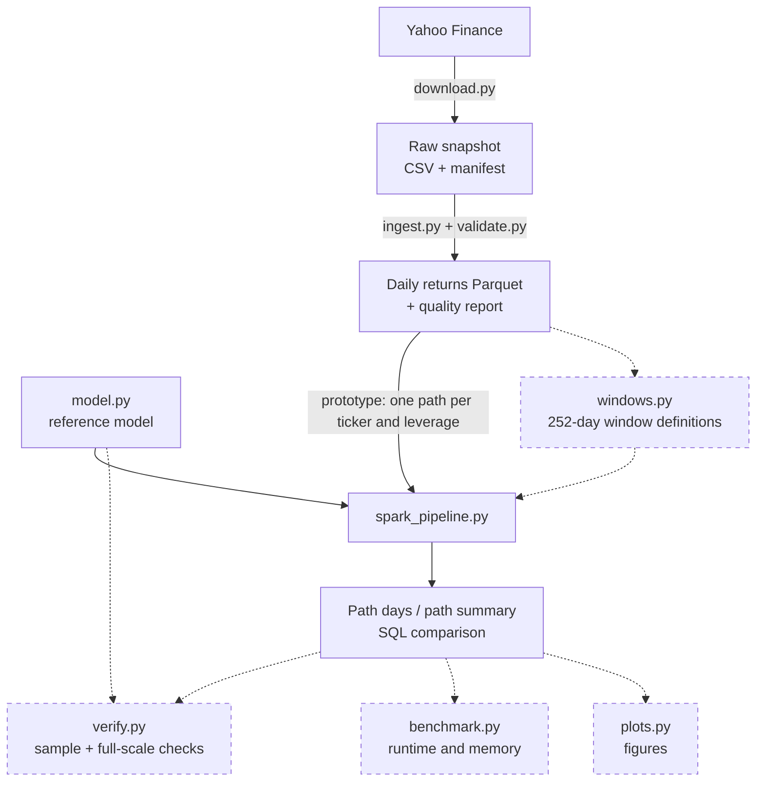

# Leveraged ETF Risk Analytics — specification

Last updated 2026-10-12, after Stage 1. Every section separates what is
**implemented** from what is **planned**. Planned parts describe intentions,
not results, and may change when each stage is reviewed.

| Stage | Scope | Status |
|---|---|---|
| Prototype | Reference model; Spark run over one full-period path per ticker and leverage; Python/Spark consistency checks; 2020–2025 data | **Implemented** |
| Stage 1 | Full-history download, checksum-enforced ingestion, data validation, [data-sources.md](data-sources.md) | **Implemented** |
| Stage 2 | Fixed 252-trading-day holding windows, with the Spark grouping keys, 1x/2x pairing, breach end dates and reference check reworked together; a first sparse-stride run with measured runtime and memory | Planned |
| Stage 3 | Reproducible environment (Docker) and performance experiments | Planned |
| Stage 4 | Figures, final documentation and demo | Planned |

## 1. Purpose and scope

This independent project studies how a fund that resets to a fixed multiple of
its underlying every trading day behaves over a holding period: its return
compared with the underlying, its drawdowns, and the rebalancing the daily
reset implies. It replays the model on historical daily returns of NVDA, AAPL,
MSFT, TSLA and QQQ, and uses Spark to run many holding windows in batch.

Out of scope: forecasting any real ETF's NAV (fees, financing and execution are
ignored), estimating the market impact of rebalancing, and probability
statements about future returns. Results describe historical windows of a few
tickers.

Course concepts applied: a Python reference implementation with tests; Parquet
with explicit schemas (PyArrow); PySpark batch processing with grouped pandas
functions; Spark DataFrame and SQL aggregation; performance measurement and a
Docker environment (both planned).

## 2. Research questions

1. **Path dependence.** Over the same fixed holding period, how does the path of
   the underlying's daily returns shape the result of a daily-reset 2x model,
   compared with the underlying itself and with twice its return?
2. **Rebalancing.** Under the model's assumptions, how large is the exposure
   adjustment the daily reset requires, relative to NAV, and how does it depend
   on leverage and the day's return? Dollar amounts scale linearly with NAV, so
   results are given per unit of NAV; a hypothetical fund size only rescales them.
3. **Spark performance.** How do workload size, partitioning and caching affect
   Spark runtime and memory for this workload on one machine, and why?

## 3. Model — implemented (`src/etf_risk/model.py`)

With `r_t` the underlying's simple return on day `t`, `L` the daily target
leverage and `V_(t-1)` the NAV at the start of day `t`:

```text
V_t               = V_(t-1) × (1 + L × r_t)
exposure_before_t = L × V_(t-1) × (1 + r_t)     end of day, before the reset
exposure_target_t = L × V_t                     after the reset
rebalance_t       = exposure_target_t − exposure_before_t = L × (L − 1) × V_(t-1) × r_t
```

A positive rebalance adds exposure, a negative one cuts it. It is a
model-implied amount, not observed trading.

**Assumptions**

- The fund holds exposure `L × V_(t-1)` during day `t`, does not trade intraday,
  and resets to `L × V_t` at the close.
- Underlying returns are total returns (computed from Adj Close, so dividends
  are reinvested).
- No fees, financing costs, interest on cash, creations or redemptions, taxes,
  tracking error or trading costs, so the NAV is not a forecast of any real ETF.
- `L > 0` (no inverse funds). Every path starts at NAV 100, and NAV carries over
  from day to day.
- Invalid input raises an error and is never treated as a breach: returns must
  be finite and at least −100%, and `L` and the starting NAV must be finite and
  positive.

**Breach rule.** If `1 + L × r_t ≤ 0`, the NAV would reach zero or go negative,
which the model cannot represent. Day `t` is recorded with status `breach`, NaN
NAV, NaN target exposure and NaN rebalance, and the path stops; later days are
not output, so a breached path is shorter than its input. The path summary
reports `breached`, `breach_day`, and NaN `final_nav` and `total_return`;
drawdown and rebalance metrics cover the days before the breach. A breach is a
model boundary, not a modeled liquidation of a real product. For `L = 2` it
requires a daily return of −50% or worse.

**Per-day output**: `day, daily_return, nav_start, nav, exposure_before,
exposure_target, rebalance, status, running_peak, drawdown`. The running peak
includes the starting NAV, and `drawdown_t = 1 − V_t / running_peak_t`.

**Path summary** (`summarize_path`): `days_ok, breached, breach_day, final_nav,
total_return, max_drawdown, total_abs_rebalance, max_abs_rebalance`.

**Planned (Stage 2)**: daily turnover `|rebalance_t| / V_(t-1)` with its mean and
maximum per window, and each window's realized variance `Σ r_t²` for question 1.

## 4. Data inputs and outputs

### Implemented

| Artifact | Location (gitignored) | Produced by | Contents |
|---|---|---|---|
| Raw snapshot | `data/raw/yahoo/<snapshot>/` | `download.py` | one CSV per ticker (Date, Open, High, Low, Close, Adj Close, Volume, Dividends, Stock Splits; QQQ also has Capital Gains, all zero in `full-2026-10-12` and unused) and `manifest.json` (download time, tool versions, request settings, rows, dates, SHA-256 per file); the prototype snapshot sits in `data/raw/yahoo/` with `verification.json` |
| Daily returns | `data/processed/<snapshot>/daily_returns/<TICKER>.parquet` | `ingest.py` | `ticker` string, `date` date32, `adjusted_price` double, `daily_return` double (null on the first row); schema metadata naming the source, snapshot and checksums |
| Quality report | `data/processed/<snapshot>/quality_report.json` | `ingest.py` | per-ticker check results, a verification-status block, and the list of unverified extreme days |
| Prototype path output | `data/outputs/<run>/path_days/`, `path_summary/` (Parquet) | `spark_pipeline.py` | one row per (ticker, leverage, day); one row per (ticker, leverage) |

Snapshots: `full-2026-10-12` (five tickers, each from its first trading day to
2025-12-31; used for the main analysis) and the 2020–2025 snapshot of the four
stocks (prototype only). Settings, checksums and limitations are recorded in
[data-sources.md](data-sources.md).

**Data status: partially checked, not fully verified.** Trading dates match the
NYSE schedule from pandas_market_calendars; Adj Close is consistent with Yahoo's
own dividend records; none of the 23 split-day returns resembles an unadjusted
split, which does not prove that every split adjustment is correct. No second
source has been compared, the terms of use have not been reviewed, and **36
extreme days are unverified**, including AAPL 2000-09-29 (−51.9%).

### Planned

- **Window definitions** (Stage 2): Parquet files with their configuration and
  SHA-256; one table for the rolling 252-day windows and a separate one for the
  calendar-year supplement, each with one row per window: `ticker, window_days,
  entry_date, first_return_date, exit_date, contains_unverified_day` (plus
  `stride` for rolling windows).
- **Windowed path output** (Stage 2): path days keyed by `(ticker, window_days,
  entry_date, leverage, day)`; one summary row per window and leverage with the
  scheduled `exit_date`, `last_ok_date` and `breach_date`; one paired row per
  window comparing 1x and 2x.
- **Measurements** (Stage 3): a CSV of timed runs (configuration, input size,
  partitions, runtime, peak memory, status, repeat) and an environment record.
- **Figures** (Stage 4): generated from the result files, never edited by hand.

## 5. Module hierarchy and data flow

```text
src/etf_risk/
  download.py        implemented  Yahoo Finance -> raw snapshot + manifest (network; "download" dependency group)
  ingest.py          implemented  raw snapshot -> validated daily returns (Parquet) + quality report
  validate.py        implemented  data checks used by ingest (pure functions)
  model.py           implemented  sequential reference model for one path
  spark_pipeline.py  prototype    model.py run per path in Spark, Spark summaries, SQL comparison, Python check
  windows.py         planned      window definitions (Stage 2)
  verify.py          planned      sample reference check and full-scale Spark checks (Stage 2)
  benchmark.py       planned      timed runs with memory sampling (Stage 3)
  plots.py           planned      figures from result files (Stage 4)
tests/               implemented  model, validation, ingest, download, Spark consistency, AI-log tooling
.claude/hooks/       implemented  per-message AI-usage logs with redaction (project tooling, not analysis)
```

Names of planned modules are provisional.



Solid boxes and arrows are implemented; dashed ones are planned.

Inside `spark_pipeline.py` (prototype): returns are filtered to non-null rows,
cross-joined with the leverage list, grouped by path key, and each group is
passed to `model.simulate_path` with `applyInPandas` after sorting by date
inside the group, so input row order is never relied on. Path summaries are
computed separately with Spark aggregations rather than by calling
`summarize_path`, so that comparing the two is a real check.

## 6. Validation approach

### Implemented

- **Data (Stage 1)**: checksum of every raw file against its manifest; duplicate
  dates and invalid prices or volumes are errors; trading calendar compared with
  the NYSE schedule, each ticker only within its own date range, where a session
  without a row or a row on a non-session day is an error and market closures
  are listed; split-day returns compared with what an unadjusted split would
  show; dividend steps compared with Yahoo's reported dividends; zero-volume rows
  and rows without an intraday range reported; extreme days listed as
  unverified. What each check does not establish is stated in
  [data-sources.md](data-sources.md).
- **Model**: hand-calculated cases in `tests/test_model.py` (zero returns, a
  single up or down day, two up days, a round trip that loses value at 2x, the
  starting NAV as a drawdown peak, the rebalance closed form, no rebalancing at
  1x, a breach on day 2, exactly −50% at 2x as a breach, invalid inputs).
- **Spark versus Python (prototype)**: the same input in shuffled order and with
  1, 3 and 7 partitions gives the same summaries; path days match row by row; a
  breached path matches; tolerance `rtol = atol = 1e-9` on the same input files.
- **Provenance**: ingest refuses a raw file whose SHA-256 differs from its
  manifest, and outputs record the snapshot they came from.
- **Limits of these checks**: Spark and the Python reference share
  `simulate_path`, so their agreement cannot reveal an error in the model
  itself; the hand-calculated cases cover that. Data errors that are internally
  consistent are not detected without a second source.

The tests in `tests/` cover the model, data validation, ingest, download (with
a fake fetch function), Python/Spark consistency, and the AI-log tooling; none
uses the network. Run them with `uv run pytest`.

### Planned (Stage 2)

- **Complete windows**: every window has exactly 252 input rows; output rows are
  252, or `breach_day` for a breached path.
- **Pairing**: exactly one summary row per window and leverage, and 1x and 2x
  compared on the same window definition.
- **1x identity**: for every window, the 1x total return equals exit price ÷
  entry price − 1, computed in Spark at full scale.
- **Model identities** for every 2x window without a breach (sections 8.1 and
  8.2): the exact log-return gap and the drawdown bound.
- **No negative NAV** anywhere.
- **Reference check** as a separate `verify` command: windows sliced from the
  returns independently of the Spark window construction and compared on a
  sample (one ticker at the sparse stride, every breached window, the first and
  last windows), filtered in Spark before collecting to the driver, and never
  run inside timed benchmarks.
- **Unverified days**: windows containing an unverified extreme day are flagged,
  and results that use them are reported as unverified.

## 7. Planned: fixed 252-trading-day windows (Stage 2)

- **Definition.** A window is 252 consecutive daily returns of one ticker (253
  prices). The entry is the close on `entry_date`, the price date before the
  first return; the exit is the close on `exit_date`, the last return date.
  Fixing the number of trading days keeps holding periods comparable; the
  calendar length is about one year and varies with holidays and closures.
- **Rolling windows** (main analysis). A new window starts every `stride`
  trading days, and only complete windows are used. The first runs use a sparse
  stride (for example 21); windows starting every day (stride 1) are attempted
  only after memory and runtime have been measured at sparser strides.

  | Stride | Windows (5 tickers) | Path-day rows at 1x and 2x |
  |---|---|---|
  | 21 | 1,790 | 902,160 |
  | 1 | 37,550 | 18,925,200 |

  These counts follow from the row counts of `full-2026-10-12`. Memory and
  runtime have not been measured and are not inferred from them.
- **Calendar-year windows** (labeled supplement). Entry at the previous year's
  last close; complete years only: 151 ticker-years (AAPL 45, MSFT 39, NVDA 26,
  QQQ 26, TSLA 15). Their lengths vary (2001, for example, lost four sessions
  after 9/11), so they are not mixed with the fixed-length windows.
- **Keys and pairing.** Path key `(ticker, window_days, entry_date, leverage)`.
  1x and 2x use the same window definitions and are compared in one row per
  window by conditional aggregation on the window key, replacing the
  prototype's ticker-only join.
- **End dates.** The scheduled `exit_date` comes from the window definition. A
  breached path ends early, so its `last_ok_date` and `breach_date` are reported
  separately; the prototype's end date, taken from simulated rows, is replaced.
- **Reporting rules.** Results are reported per ticker; any pooled figure is
  labeled as pooled, and QQQ, which holds the other four tickers, is not pooled
  with them. Overlapping rolling windows are described as overlapping, and the
  non-overlapping windows are descriptive observations, not independent
  samples. No probability or confidence statements are based on window counts.

## 8. Expected results

These are expectations derived from the model, written down before the Stage 2
runs so the results can be checked against them rather than fitted afterwards.

1. **Path dependence (question 1).** Each day, `(1 + r)² − (1 + 2r) = r²`, so for
   a 2x window without a breach the log-return gap is exactly

   ```text
   log(1 + R_2x) − 2 × log(1 + R_1x) = Σ log(1 − (r_t / (1 + r_t))²)  ≤ 0
                                      ≈ −Σ r_t²   (realized variance; error of order Σ r_t³)
   ```

   In log terms the 2x model always falls short of twice the underlying, by about
   the window's realized variance. In simple returns it can still beat twice the
   underlying's return in strong, steady trends, because compounding adds
   `R_1x²`, and it falls short in volatile windows without a trend. Checked so
   far only outside the pipeline, on the 2020–2025 prototype data: the exact
   identity matches the model output to about 1e−15 on all four full-period
   paths, and the approximation is within 5% of the exact gap in 18 of 20
   non-overlapping 252-day blocks; the largest difference, 13.8% for NVDA in
   2023, comes from a block with a +24.4% day.
2. **Drawdowns.** Each day `1 + L r ≤ (1 + r)^L` for `L ≥ 1` (Bernoulli's
   inequality). Over the interval from the 1x path's peak to its trough, the
   leveraged NAV therefore ends at no more than `(1 − MDD_1x)^L` times its value
   at the start of that interval. For every window without a breach,
   `MDD_2x ≥ 1 − (1 − MDD_1x)²`: a 30% drawdown at 1x implies at least 51% at 2x.
   The four prototype paths satisfy this (NVDA: 1x 66.3%, bound 88.7%, 2x 92.1%).
3. **Breaches.** At 2x only a day of −50% or worse causes a breach. In
   `full-2026-10-12` the only such day is AAPL 2000-09-29 (−51.9%, unverified),
   so breached 2x windows are expected only among AAPL windows that include it,
   and every result about them will be labeled unverified.
4. **Rebalancing (question 2).** Under the model, the rebalance as a fraction of
   that day's starting NAV is exactly `L(L − 1) r_t`: for 2x, twice the day's
   return, adding exposure after up days and cutting it after down days. Daily
   turnover is therefore `2 |r_t|`, and its distribution per ticker is that of
   `|r_t|` rescaled. The results will report magnitudes, not market impact. The
   largest values fall on extreme days, which are unverified.
5. **Spark performance (question 3).** These are hypotheses to test, not
   findings. At sparse strides, fixed costs (starting the Spark session and the
   Python workers) should dominate. Larger workloads should take longer roughly
   in proportion to the number of windows. Expanding returns into windows
   multiplies the rows Spark has to shuffle by about `252 / stride`, and running
   one grouped pandas call per window adds a per-window Python cost. Spark's
   adaptive execution may merge shuffle partitions, so requested and actual
   partition counts will both be recorded. A single-process pandas run may be
   faster at these sizes. Memory will be measured, not estimated. The only
   timing so far is one informal prototype run (8 paths, about 12 seconds end to
   end), which is not a benchmark.

## 9. Status summary

| Area | Implemented (prototype and Stage 1) | Planned (Stage 2 and later) |
|---|---|---|
| Data | download with manifest; five-ticker full-history snapshot; checksum-enforced ingest; calendar, split-day, dividend, zero-volume and flat-bar checks; list of unverified extreme days | second-source comparison; terms-of-use review |
| Model | daily-reset model, breach rule, drawdown, rebalance; hand-calculated tests | daily turnover and realized-variance metrics per window |
| Spark | one full-period path per (ticker, leverage); separate Spark summaries; SQL comparison joined on ticker only; Python check that collects all summaries | window keys; 1x/2x pairing on the window key; scheduled vs actual end dates; `verify` command on a sample; full-scale checks in Spark |
| Windows | none | fixed 252-day rolling windows (sparse stride first); calendar-year supplement |
| Performance | none | workload size via stride, partition counts, optional caching; runtime and peak memory measured |
| Environment | uv lockfile; pandas below 3 for PySpark; pandas-market-calendars 5.5.0 and yfinance 1.7.0 pinned exactly | Docker; a NumPy pin (pandas 2.3 emits deprecation warnings under NumPy 2.5) |
| Documentation | README, [data-sources.md](data-sources.md), this specification, [AI-usage logs](ai-usage/README.md) | design decisions, results, demo script |

## 10. Known issues carried into Stage 2

- With windows, the prototype comparison query, which joins 1x to 2x on ticker
  only, would pair every 2x window with every 1x window of the same ticker.
- Path end dates come from the simulated rows, which a breach shortens.
- The prototype Python check collects every path summary to the driver and
  reruns every path in a Python loop, which would not scale and must stay
  outside timed runs.

Stage 2 replaces all three, as described in sections 6 and 7.
